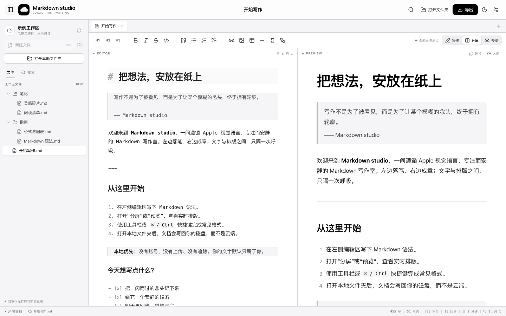
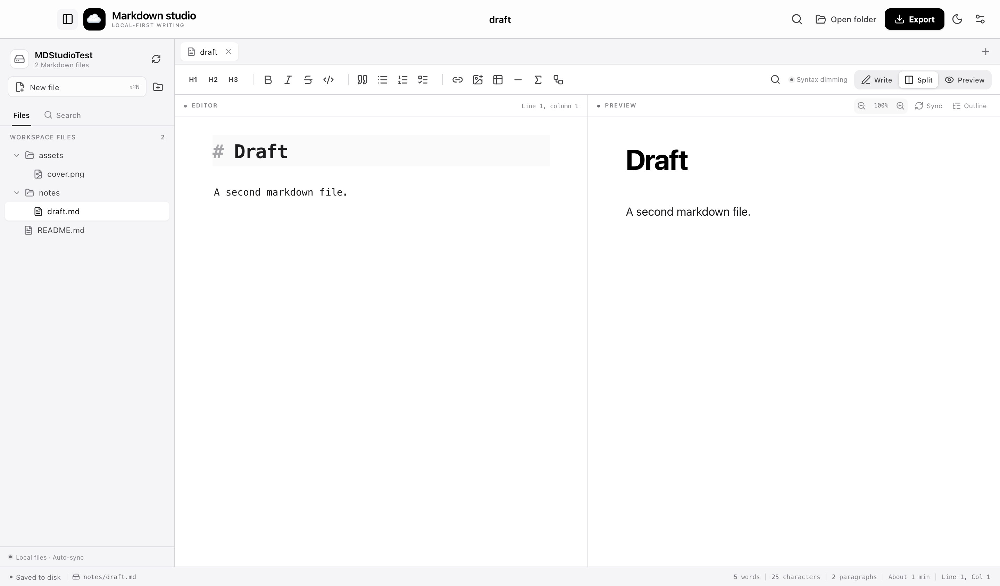

# Markdown studio

**English** · [中文](./README.zh-CN.md)

A local-first Markdown writing studio built with **React + TypeScript + Vite**. It uses an Apple-inspired black-and-white visual language and brings immersive editing, live typography, local file management, rich-content rendering, and multi-format export into a single workflow.

It ships as a **macOS desktop app, a Windows x64 installer, and a web app**.



<sub>Light theme · [Dark theme](docs/preview-dark.png) · [Workspace search](docs/search.png) · [Find in file](docs/file-search.png) · [Find in preview](docs/preview-search.png) · [Math and diagrams](docs/rich-content.png) · [Mobile](docs/mobile.png)</sub>

## macOS desktop app

| Package | Description |
| --- | --- |
| [Markdown-studio-2.0.0-arm64.dmg](release/Markdown-studio-2.0.0-arm64.dmg) | Recommended; drag it into Applications |
| [Markdown-studio-2.0.0-arm64.zip](release/Markdown-studio-2.0.0-arm64.zip) | Unzip to get the `.app` |
| [Markdown studio.app](<release/mac-arm64/Markdown studio.app>) | Signed application bundle |
| [SHA256SUMS.txt](docs/release/SHA256SUMS.txt) | Verify package integrity (run `shasum -a 256 -c SHA256SUMS.txt` next to the downloads) |
| [macOS installation guide](docs/release/Installation-Guide-macOS.txt) | Gatekeeper, installation steps, and checksum notes |



> The installers themselves are git-ignored build artifacts in `release/`, not committed files; the
> guides, checksums, and signing notes are versioned in [docs/release](docs/release/README.md).
>
> The package targets **Apple Silicon (arm64)** and uses ad-hoc signing without Apple Developer ID notarization. If Gatekeeper blocks the first launch, right-click the app in Finder and choose "Open". Public distribution will require a developer certificate signature and notarization.

Desktop capabilities:

- Native "Open Folder" dialog with direct local disk access, no browser permission prompts.
- Remembers the last workspace and restores it on the next launch.
- Clipboard screenshots are written to the workspace `assets/` folder and inserted as relative-path Markdown.
- Native "Save As" dialogs for PDF / HTML / DOCX / long-image export.
- External links open in the system browser.
- Custom macOS hidden title bar, window drag region, and app icon.

## Windows desktop app

| Package | Description |
| --- | --- |
| [Markdown-studio-2.0.0-x64-setup.exe](release/Markdown-studio-2.0.0-x64-setup.exe) | Installer with a selectable install directory; creates desktop and Start menu shortcuts |
| [Markdown-studio-2.0.0-x64-portable.exe](release/Markdown-studio-2.0.0-x64-portable.exe) | Portable build; double-click to run |
| [Windows installation guide](docs/release/Windows-Installation-Guide.txt) | SmartScreen, checksums, and usage notes |

Targets **Windows 10 / 11 x64**. The current installers are not code-signed, so SmartScreen may warn about an "Unknown publisher"; click "More info" → "Run anyway". Installer SHA256 hashes are listed in [SHA256SUMS.txt](docs/release/SHA256SUMS.txt).

> The current build was cross-compiled on macOS. The PE/NSIS structure, embedded `app.asar`, and installer integrity have been verified, but the app has not yet been launched on a real Windows machine. Before a public release, run a launch and install regression on Windows 11.

## Key capabilities

- **Immersive live editing**: CodeMirror 6 + a custom ViewPlugin; heading, emphasis, and quote syntax is hidden on inactive lines and revealed when the cursor returns to the line. Heading levels, blockquotes, and emphasis styles render instantly.
- **Markdown and GFM**: headings, blockquotes, lists, task lists, tables, code blocks, links, images, and more.
- **Math**: `remark-math` + KaTeX, supporting inline `$...$` and block-level `$$...$$` formulas.
- **Mermaid diagrams**: fenced code blocks render as vector diagrams; a diagram error does not take down the page and is shown as a readable message in place.
- **Local workspace**: the desktop app uses the native Node file system, while the web app uses the File System Access API. Both open real folders and support a file tree, create, rename, delete, drag-to-move, tabs, external-change sync, and local saves.
- **Find and replace in file**: `⌘F` / `Ctrl F` opens a VS Code-style overlay with a live match count, previous / next, case sensitivity, whole-word matching, and regular expressions. All matches are highlighted in pale green, the current match is emphasized, and replacements can be applied one by one or all at once. Writing, split, and preview views all support search; the preview view highlights and jumps within rendered output and offers find only, without switching views.
- **Global search and replace**: a background prebuilt index + Web Worker queries, with regex, case sensitivity, per-file grouping, and multiple matches per line. Clicking a result jumps to the exact editor line and column; replace-all and per-match replace are supported.
- **Image paste and path hints**: screenshots pasted from the clipboard are written to the workspace `assets/` folder (configurable) and inserted as relative-path Markdown. Inserted images are resolved against the workspace in real time, with hints for workspace location, file size, same-name images, and available relative-path candidates. Falls back to a Data URL when no workspace is connected.
- **Image file preview**: supports PNG / JPEG / GIF / WebP / SVG / AVIF / BMP / ICO / APNG. Click an image in the file tree, an image in the preview, or a link to a workspace image to open the image viewer **inside the preview pane**, with zoom, drag-to-pan, fit-to-window, and 1:1 original size, without covering the title bar, sidebar, or editor.
- **Preview zoom**: the preview header zooms between 50% and 300% and remembers the preference; `⌘ / Ctrl` + wheel zooms quickly, and clicking the percentage resets to 100%.
- **Multi-format export**: PDF, standalone HTML, Word `.docx`, and long-image PNG, with table of contents, header, footer, and theme options.
- **Live statistics**: Chinese and English characters, word count, English words, visible characters, paragraphs, lines, reading time, and cursor position.
- **Draft recovery**: snapshots of the document being edited are stored locally in the app and can be recovered after a refresh or unexpected close; unsaved state is preserved.
- **Black-and-white themes**: light / dark mode, following the system automatically; every UI accent is built from black, white, and gray.
- **Purely local**: no accounts, no backend, no cloud uploads.

## Web quick start

Requires **Node.js 22+**.

```bash
npm install
npm run dev
```

Open the URL printed in the terminal (default **http://127.0.0.1:4173**).

Production build:

```bash
npm run build
npm run preview
```

> Local folder access on the web depends on the File System Access API; use the latest **Chrome / Edge / Chromium**. Safari and Firefox can still use the sample workspace and create scratch drafts, but cannot read or write arbitrary local folders directly. Use the macOS / Windows desktop app when you need full native file access.

## Developing and packaging the desktop app

```bash
# Vite + Electron development window
npm run desktop:dev

# Build and package .app, .zip, .dmg
npm run desktop:package
```

Build artifacts are written to `release/`. `scripts/package-macos.sh` builds, ad-hoc signs the `.app`, creates the ZIP, and attempts to create the DMG; `scripts/make-dmg.sh` can create a DMG from an existing `.app` on its own. On this machine the full pipeline takes about **19s** (build 2s / package 3s / sign 0s / ZIP 6s / DMG 8s).

To avoid "the build hangs without an error" again, the scripts do the following:

- **Offline packaging**: reuse the Electron already installed under `node_modules/electron/dist` (`--config.electronDist`) instead of letting electron-builder verify or download it over the network. When GitHub release assets are unreachable, it can hang in TCP `SYN_SENT` without printing anything, which was exactly the cause of the earlier "hang with no error".
- **Visible progress**: each stage prints a title and elapsed time; electron-builder is protected by `BUILDER_TIMEOUT` (900s by default), which produces a clear message instead of waiting forever.
- **Safe artifacts**: the DMG is first written as `*.partial.dmg` and only replaces the old file after `hdiutil verify` passes (the old `-ov` flag would destroy the previous DMG on failure); failures print the specific reason instead of being silently skipped.
- **No silent freeze**: background helpers run with stdin closed (`</dev/null`), because a backgrounded tool that reads the terminal is stopped by SIGTTIN and looks exactly like a hang; on timeout the whole process tree (`npx → npm → electron-builder`) is killed, so no orphan keeps holding `release/`.
- **ZIP-only escape hatch**: `SKIP_DMG=1 npm run dist:mac` produces only the `.app` and `.zip`, which is what you want in a sandbox or CI where `hdiutil` cannot create disk images (`hdiutil` reports that as a misleading "directory not empty").

Troubleshooting: if you still suspect a hang, capture a stack sample with `sample $(pgrep -f "electron-builder|package-macos") 3 -file ~/Desktop/build-hang.txt`; if the network is genuinely restricted, retry through a mirror with `ELECTRON_MIRROR=https://npmmirror.com/mirrors/electron/ npm run dist:mac`.

## Keyboard shortcuts

| Action | macOS | Windows / Linux |
| --- | --- | --- |
| Bold | `⌘ B` | `Ctrl B` |
| Italic | `⌘ I` | `Ctrl I` |
| Insert link | `⌘ K` | `Ctrl K` |
| Save / export `.md` | `⌘ S` | `Ctrl S` |
| Open local folder | `⌘ O` | `Ctrl O` |
| Find in file | `⌘ F` | `Ctrl F` |
| Replace in file | `⌥ ⌘ F` | `Ctrl H` / `Ctrl Alt F` |
| Next / previous match | `Enter` / `Shift Enter` in the find box, or `F3` / `Shift F3` | `Enter` / `Shift Enter` in the find box, or `F3` / `Shift F3` |
| Close find | `Esc` | `Esc` |
| Global search | `⇧ ⌘ F` | `Ctrl Shift F` |
| New blank document | `⌘ N` | `Ctrl N` |
| New workspace file | `⇧ ⌘ N` | `Ctrl Shift N` |
| Settings | `⌘ ,` | `Ctrl ,` |
| Indent / outdent | `Tab` / `Shift Tab` | `Tab` / `Shift Tab` |
| Zoom preview | `⌘` + wheel | `Ctrl` + wheel |
| Image viewer zoom | `⌘ +` / `⌘ -` / `⌘ 0` | `Ctrl +` / `Ctrl -` / `Ctrl 0` |
| Close image viewer | `Esc` | `Esc` |

List continuation is handled by the CodeMirror Markdown keymap: ordered lists, unordered lists, task lists, and blockquotes all inherit their level and marker automatically.

## Project scripts

| Command | Description |
| --- | --- |
| `npm run dev` | Vite development server |
| `npm run build` | TypeScript check + production build |
| `npm run preview` | Preview the production build |
| `npm run typecheck` | `tsc --noEmit` |
| `npm run lint` | ESLint (TypeScript + React Hooks) |
| `npm test` | Vitest unit and integration tests |
| `npm run ci` | lint + typecheck + test + build |
| `npm run desktop:dev` | Electron + Vite development mode |
| `npm run desktop` | Build, then launch the local Electron window |
| `npm run desktop:package` | Generate the macOS installer |
| `npm run dist:win` | Generate the Windows x64 NSIS installer and portable build |

Current verification results: **96 tests passing**; the web production build, macOS desktop packaging, and Windows x64 cross-packaging all succeed. Two rounds of architecture optimization were completed on 2026-11-10 (stable document ids, per-document IndexedDB sessions, a persistent Worker search index, native desktop file watching, viewport-level live decorations, Electron security hardening, and first-screen code splitting); see [docs/OPTIMIZATION-CHECKLIST.md](docs/OPTIMIZATION-CHECKLIST.md) for details. On a local production preview, cold start to the editor is about **193 ms** and to the first preview about **207 ms** (1440×900, measured 2026-11-09); a document of roughly 65k characters loads in about 60 ms, scrolling was measured at 60 frames per second, and no long tasks were detected during typing. The macOS build has been mounted and launched from the DMG to verify native workspace read/write, image paste, search, and last-workspace restore; the Windows build has had `MarkdownStudio.exe`, `app.asar`, and the NSIS archive structure verified, but has not been run on a real Windows machine.

## Repository layout

```text
electron/                # Electron main process, preload, native file system
build/                   # macOS app icon
scripts/                 # Desktop dev and packaging scripts
release/                 # DMG / ZIP / .app (build artifacts, git-ignored)
docs/release/            # Versioned release guides, SHA256SUMS, and release notes
src/
├── app/                 # Zustand state: workspace, preferences, UI
├── components/
│   ├── layout/          # AppBar, status bar
│   ├── sidebar/         # File tree, global search
│   ├── editor/          # CodeMirror editor, live typography, find-in-file, format commands
│   ├── search/          # Shared find bar (editor / preview)
│   ├── preview/         # Markdown, KaTeX, Mermaid, code blocks
│   ├── dialogs/         # New, rename, delete, settings, export
│   └── ui/              # Modal, segmented control, Toast, etc.
├── services/
│   ├── file-system/     # Web / Electron dual-backend workspace services
│   ├── search/          # Workspace search, find-in-file / find-in-preview core + Worker
│   ├── markdown/        # Statistics, outline, Mermaid theme
│   └── export/          # HTML / PDF / PNG / DOCX
├── hooks/               # Session recovery, theme, shortcuts, workspace actions
├── styles/              # Design tokens and layered CSS
├── workers/             # Search Worker
└── types/               # Domain types
docs/
├── ARCHITECTURE.md              # Architecture guide (English, must-read)
├── ARCHITECTURE.zh-CN.md        # Architecture guide (Chinese)
├── OPTIMIZATION-CHECKLIST.md    # Optimization checklist (English)
├── OPTIMIZATION-CHECKLIST.zh-CN.md  # Optimization checklist (Chinese)
├── desktop.png
├── preview.png
├── preview-dark.png
├── search.png
├── file-search.png
├── preview-search.png
├── rich-content.png
└── mobile.png
```

For the full module boundaries, data flow, performance strategy, desktop bridge, PRD acceptance mapping, and known limitations, see **[docs/ARCHITECTURE.md](docs/ARCHITECTURE.md)**. The Chinese edition is **[docs/ARCHITECTURE.zh-CN.md](docs/ARCHITECTURE.zh-CN.md)**, and the Chinese README is **[README.zh-CN.md](README.zh-CN.md)**.
