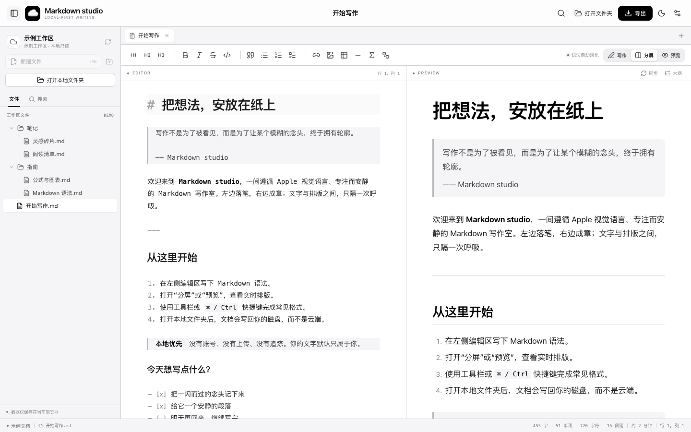
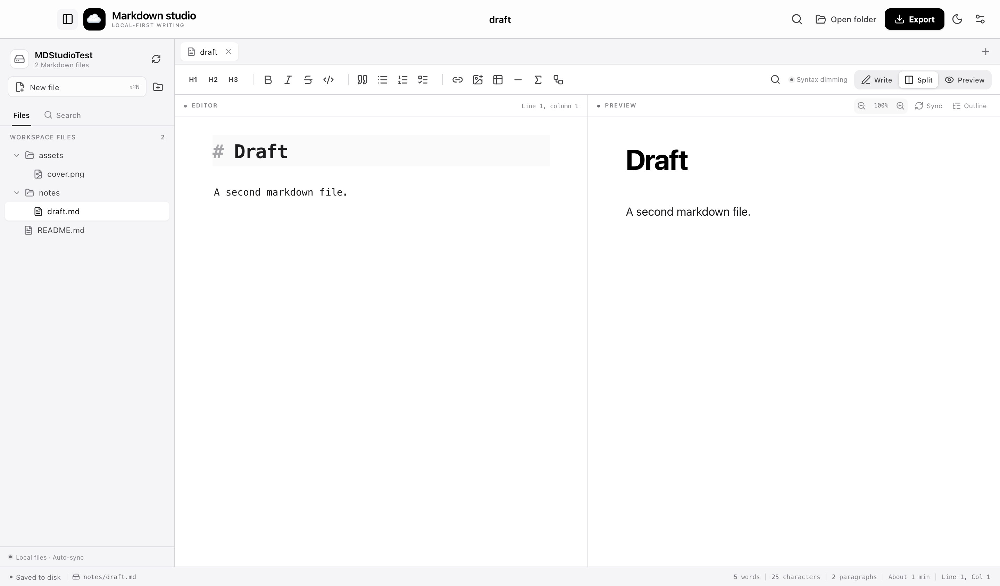

# Markdown studio

[English](./README.md) · **中文**

一个 **React + TypeScript + Vite** 实现的本地优先 Markdown 写作工作台。采用 Apple 风格的黑白视觉语言，把「沉浸式编辑 / 实时排版 / 本地文件管理 / 富文本渲染 / 多格式导出」放在同一个工作流里。

同时提供 **macOS 桌面应用、Windows x64 安装包** 和 **Web 版本**。



<sub>白色主题 · [深色主题](docs/preview-dark.png) · [工作区搜索](docs/search.png) · [文件内查找](docs/file-search.png) · [预览内查找](docs/preview-search.png) · [公式与图表](docs/rich-content.png) · [移动端](docs/mobile.png)</sub>

## macOS 桌面应用

| 安装包 | 说明 |
| --- | --- |
| [Markdown-studio-2.0.1-arm64.dmg](release/Markdown-studio-2.0.1-arm64.dmg) | 推荐，拖入「应用程序」即可 |
| [Markdown-studio-2.0.1-arm64.zip](release/Markdown-studio-2.0.1-arm64.zip) | 解压后得到 `.app` |
| [Markdown studio.app](<release/mac-arm64/Markdown studio.app>) | 已签名的应用包 |
| [SHA256SUMS.txt](docs/release/SHA256SUMS.txt) | 校验安装包完整性（在下载目录执行 `shasum -a 256 -c SHA256SUMS.txt`） |
| [English](docs/release/Installation-Guide-macOS.txt) · [安装说明](docs/release/安装说明.txt) | Gatekeeper、安装步骤与校验说明 |



> 安装包本身是 `release/` 下被 Git 忽略的构建产物，不入库；安装说明、校验清单与签名说明随文档一起
> 版本化在 [docs/release](docs/release/README.zh-CN.md)。
>
> 安装包面向 **Apple Silicon（arm64）**，使用 ad-hoc 签名，未使用 Apple Developer ID 公证。首次打开如被 Gatekeeper 拦截，请在 Finder 中右键应用 →「打开」。正式面向公众分发前需要开发者证书签名与 notarization。

桌面版能力：

- 原生「打开文件夹」对话框，直接读写本地磁盘，无需浏览器授权。
- 记住上次工作区，下次启动自动恢复。
- 剪贴板截图直接写入工作区 `assets/`，并插入相对路径。
- 导出 PDF / HTML / DOCX / 长图时使用原生「另存为」对话框。
- 外部链接交给系统浏览器打开。
- 自定义 macOS 隐藏标题栏、窗口拖拽区和应用图标。

## Windows 桌面应用

| 安装包 | 说明 |
| --- | --- |
| [Markdown-studio-2.0.0-x64-setup.exe](release/Markdown-studio-2.0.0-x64-setup.exe) | 安装版，可选择安装目录，创建桌面/开始菜单快捷方式 |
| [Markdown-studio-2.0.0-x64-portable.exe](release/Markdown-studio-2.0.0-x64-portable.exe) | 免安装便携版，双击运行 |
| [English](docs/release/Windows-Installation-Guide.txt) · [Windows 安装说明](docs/release/Windows-安装说明.txt) | SmartScreen、校验和与使用说明 |

面向 **Windows 10 / 11 x64**。当前安装包未使用 Windows 代码签名证书，SmartScreen 可能提示“未知发布者”；点击「更多信息」→「仍要运行」即可。安装包 SHA256 见 [SHA256SUMS.txt](docs/release/SHA256SUMS.txt)。

> 当前构建在 macOS 上交叉完成。已验证 PE/NSIS 结构、嵌入的 `app.asar` 与安装器完整性，但尚未在 Windows 实机启动验证；正式对外发布前建议在 Windows 11 上做一次启动与安装回归。

## 主要能力

- **沉浸式实时编辑**：CodeMirror 6 + 自定义 ViewPlugin；标题、强调、引用等语法在非当前行自动隐藏，光标回到该行时恢复标记。标题层级、引用块、强调样式即时呈现。
- **Markdown 与 GFM**：标题、引用、列表、任务列表、表格、代码块、链接、图片等。
- **数学公式**：`remark-math` + KaTeX，支持行内 `$...$` 与块级 `$$...$$` 公式。
- **Mermaid 图表**：代码块自动渲染为矢量图；错误不会拖垮页面，会在图表位置展示可读的错误信息。
- **本地工作区**：桌面版通过原生 Node 文件系统、Web 版通过 File System Access API 打开真实文件夹；支持文件树、新建、重命名、删除、拖拽移动、标签页、外部改动同步与本地保存。
- **文件内查找与替换**：`⌘F` / `Ctrl F` 打开 VSCode 风格浮层，实时显示匹配计数，支持上一处 / 下一处、区分大小写、全字匹配、正则表达式，全部命中使用淡绿色高亮，当前命中加深显示，并可逐条或全部替换。写作、分屏与预览视图都可以直接查找；预览视图在渲染结果中高亮和跳转，且只提供查找，不会切换视图。
- **全局搜索与替换**：后台预建索引 + Web Worker 查询，支持正则、大小写敏感、按文件聚合结果、一行内多处命中；点击结果可精确跳转到编辑器行列，并支持全部替换与逐条替换。
- **图片粘贴与路径提示**：从剪贴板粘贴截图后写入工作区 `assets/`（可配置），插入相对路径 Markdown；插入图片时会按路径实时解析，提示工作区位置、文件大小、同名图片与可用的相对路径候选。未连接工作区时退化为 Data URL。
- **图片文件预览**：支持 PNG / JPEG / GIF / WebP / SVG / AVIF / BMP / ICO / APNG；点击文件树中的图片、预览中的图片或指向工作区图片的链接，即可在**预览区内**打开图片查看器，支持缩放、拖拽平移、适应窗口与 1:1 原始尺寸，不会遮挡标题栏、侧栏和编辑区。
- **预览缩放**：预览标题栏可在 50%–300% 之间缩放并记住偏好，`⌘ / Ctrl` + 滚轮快速缩放，点击百分比一键回到 100%。
- **多格式导出**：PDF、独立 HTML、Word `.docx` 与长图 PNG，支持目录、页眉、页脚和主题选项。
- **实时统计**：中英文字符、字数、英文单词、可见字符、段落、行数、阅读时间与光标位置。
- **草稿恢复**：编辑中的文档快照保存在应用本地，刷新或意外关闭后可恢复；未保存状态会被保留。
- **黑白双主题**：白色 / 深色模式，自动跟随系统；所有 UI 强调色由黑、白、灰构成。
- **纯本地**：没有账号、后端或云端上传。

## Web 版快速开始

要求 **Node.js 22+**。

```bash
npm install
npm run dev
```

打开终端提示的地址（默认 **http://127.0.0.1:4173**）。

生产构建：

```bash
npm run build
npm run preview
```

> Web 版的本地文件夹能力依赖 File System Access API，建议使用最新版 **Chrome / Edge / Chromium**。Safari、Firefox 仍可使用示例工作区和新建草稿，但无法直接读写任意本地文件夹。需要完整原生文件能力时请使用 macOS / Windows 桌面版。

## 开发与打包桌面版

```bash
# Vite + Electron 开发窗口
npm run desktop:dev

# 构建并打包 .app、.zip、.dmg
npm run desktop:package
```

打包产物写入 `release/`。`scripts/package-macos.sh` 会构建、ad-hoc 签名 `.app`、生成 ZIP 并尝试生成 DMG；`scripts/make-dmg.sh` 可单独从现有 `.app` 生成 DMG。在本机实测，全流程约 **19s**（构建 2s / 打包 3s / 签名 0s / ZIP 6s / DMG 8s）。

为了不再出现"构建卡住却没有报错"，脚本做了这几件事：

- **离线打包**：直接复用 `node_modules/electron/dist` 里已装好的 Electron（`--config.electronDist`），不再让 electron-builder 联网校验或下载。GitHub release 资源连不通时，它会卡在 TCP `SYN_SENT` 且不打印任何错误，这正是之前"卡顿无报错"的原因。
- **进度可见**：每个阶段打印标题与耗时；electron-builder 有 `BUILDER_TIMEOUT`（默认 900s）超时保护，超时会给出明确提示而不是无限等待。
- **产物安全**：DMG 先写 `*.partial.dmg`，`hdiutil verify` 通过后才替换旧文件（旧的 `-ov` 会在失败时直接毁掉上一次的 DMG）；生成失败会打印具体原因，不再静默跳过。
- **不会静默假死**：后台子命令统一 `</dev/null` 关闭 stdin——后台进程读终端会被 SIGTTIN 停住，表现和"卡死"一模一样；超时后会杀掉整棵进程树（`npx → npm → electron-builder`），避免残留进程继续占用 `release/`。
- **只出 ZIP 的开关**：`SKIP_DMG=1 npm run dist:mac` 只生成 `.app` 和 `.zip`，适合沙箱 / CI 这类 `hdiutil` 无法创建磁盘映像的环境（此时 `hdiutil` 会给出误导性的"目录非空"）。

排查建议：仍怀疑卡住时，用 `sample $(pgrep -f "electron-builder|package-macos") 3 -file ~/Desktop/build-hang.txt` 抓调用栈；网络确实受限时用镜像重试 `ELECTRON_MIRROR=https://npmmirror.com/mirrors/electron/ npm run dist:mac`。

## 快捷键

| 操作 | macOS | Windows / Linux |
| --- | --- | --- |
| 加粗 | `⌘ B` | `Ctrl B` |
| 斜体 | `⌘ I` | `Ctrl I` |
| 插入链接 | `⌘ K` | `Ctrl K` |
| 保存 / 导出 `.md` | `⌘ S` | `Ctrl S` |
| 打开本地文件夹 | `⌘ O` | `Ctrl O` |
| 文件内查找 | `⌘ F` | `Ctrl F` |
| 文件内替换 | `⌥ ⌘ F` | `Ctrl H` / `Ctrl Alt F` |
| 下一个 / 上一个匹配 | 查找框内 `Enter` / `Shift Enter`，或 `F3` / `Shift F3` | 查找框内 `Enter` / `Shift Enter`，或 `F3` / `Shift F3` |
| 关闭查找 | `Esc` | `Esc` |
| 全局搜索 | `⇧ ⌘ F` | `Ctrl Shift F` |
| 新建空白文档 | `⌘ N` | `Ctrl N` |
| 新建工作区文件 | `⇧ ⌘ N` | `Ctrl Shift N` |
| 设置 | `⌘ ,` | `Ctrl ,` |
| 缩进 / 减少缩进 | `Tab` / `Shift Tab` | `Tab` / `Shift Tab` |
| 缩放预览 | `⌘` + 滚轮 | `Ctrl` + 滚轮 |
| 图片查看器缩放 | `⌘ +` / `⌘ -` / `⌘ 0` | `Ctrl +` / `Ctrl -` / `Ctrl 0` |
| 关闭图片查看器 | `Esc` | `Esc` |

列表续行由 CodeMirror Markdown keymap 处理：有序列表、无序列表、任务列表和引用都会自动继承层级与标记。

## 工程脚本

| 命令 | 说明 |
| --- | --- |
| `npm run dev` | Vite 开发服务器 |
| `npm run build` | TypeScript 检查 + 生产构建 |
| `npm run preview` | 预览生产构建 |
| `npm run typecheck` | `tsc --noEmit` |
| `npm run lint` | ESLint（TypeScript + React Hooks） |
| `npm test` | Vitest 单元与集成测试 |
| `npm run ci` | lint + typecheck + test + build |
| `npm run desktop:dev` | Electron + Vite 开发模式 |
| `npm run desktop` | 构建后启动本地 Electron 窗口 |
| `npm run desktop:package` | 生成 macOS 安装包 |
| `npm run dist:win` | 生成 Windows x64 NSIS 安装版和便携版 |

当前验证结果：**96 个测试通过**；Web 生产构建、macOS 桌面打包和 Windows x64 交叉打包成功；2026-11-10 完成两轮架构优化（稳定文档 id、按文档 IndexedDB 会话、Worker 常驻搜索索引、桌面原生文件监听、视口级实时装饰、Electron 安全加固与首屏分块），详见 [docs/OPTIMIZATION-CHECKLIST.zh-CN.md](docs/OPTIMIZATION-CHECKLIST.zh-CN.md)；本地生产预览冷启动到编辑器约 **193 ms**、到首屏预览约 **207 ms**（1440×900，2026-11-09 实测）；约 6.5 万字符文档首次加载约 60 ms，滚动测试为 60 帧 / 秒，输入期间未检测到长任务。macOS 版已从 DMG 实际挂载启动，验证原生工作区读写、图片粘贴、搜索和上次工作区恢复；Windows 版已校验安装包内的 `MarkdownStudio.exe`、`app.asar` 和 NSIS 归档结构，但未进行 Windows 实机运行。

## 目录

```text
electron/                # Electron 主进程、preload、原生文件系统
build/                   # macOS 应用图标
scripts/                 # 桌面开发与打包脚本
release/                 # DMG / ZIP / .app（构建产物，已忽略）
docs/release/            # 版本化的发布说明、SHA256SUMS 与安装指南
src/
├── app/                 # Zustand 状态：工作区、偏好、UI
├── components/
│   ├── layout/          # AppBar、状态栏
│   ├── sidebar/         # 文件树、全局搜索
│   ├── editor/          # CodeMirror 编辑器、实时排版、文件内查找、格式命令
│   ├── search/          # 通用查找条（编辑器 / 预览共用）
│   ├── preview/         # Markdown、KaTeX、Mermaid、代码块
│   ├── dialogs/         # 新建、重命名、删除、设置、导出
│   └── ui/              # Modal、分段控件、Toast 等
├── services/
│   ├── file-system/     # Web / Electron 双后端工作区服务
│   ├── search/          # 工作区搜索、文件内 / 预览内查找 core + Worker
│   ├── markdown/        # 统计、大纲、Mermaid 主题
│   └── export/          # HTML / PDF / PNG / DOCX
├── hooks/               # 会话恢复、主题、快捷键、工作区动作
├── styles/              # 设计 token 与分层 CSS
├── workers/             # 搜索 Worker
└── types/               # 领域类型
docs/
├── ARCHITECTURE.md              # 项目架构文档（英文，必读）
├── ARCHITECTURE.zh-CN.md        # 中文版项目架构文档
├── OPTIMIZATION-CHECKLIST.md    # 架构优化清单（英文）
├── OPTIMIZATION-CHECKLIST.zh-CN.md  # 中文版架构优化清单
├── desktop.png
├── preview.png
├── preview-dark.png
├── search.png
├── file-search.png
├── preview-search.png
├── rich-content.png
└── mobile.png
```

完整模块边界、数据流、性能策略、桌面桥、PRD 验收映射与已知限制见 **[docs/ARCHITECTURE.zh-CN.md](docs/ARCHITECTURE.zh-CN.md)**；英文版见 **[docs/ARCHITECTURE.md](docs/ARCHITECTURE.md)**。README 的英文版见 **[README.md](README.md)**。
