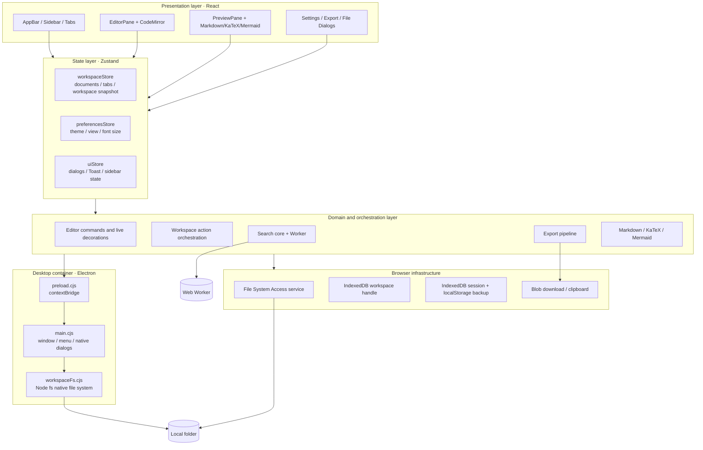
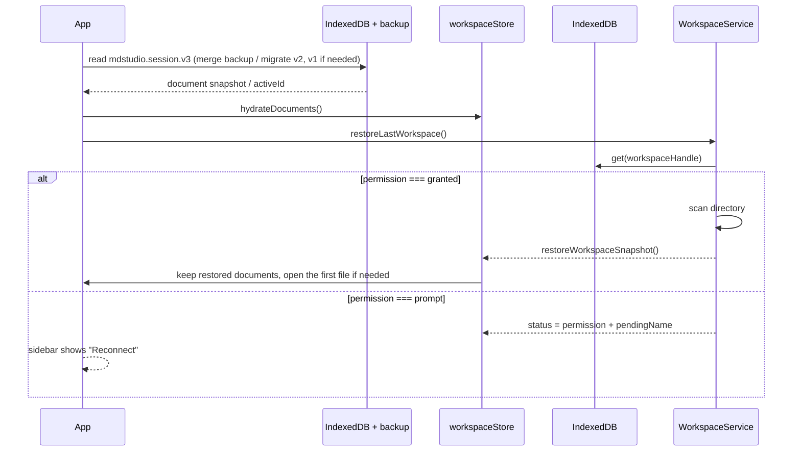
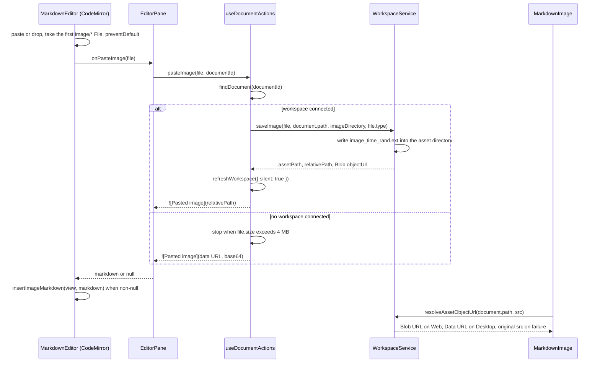
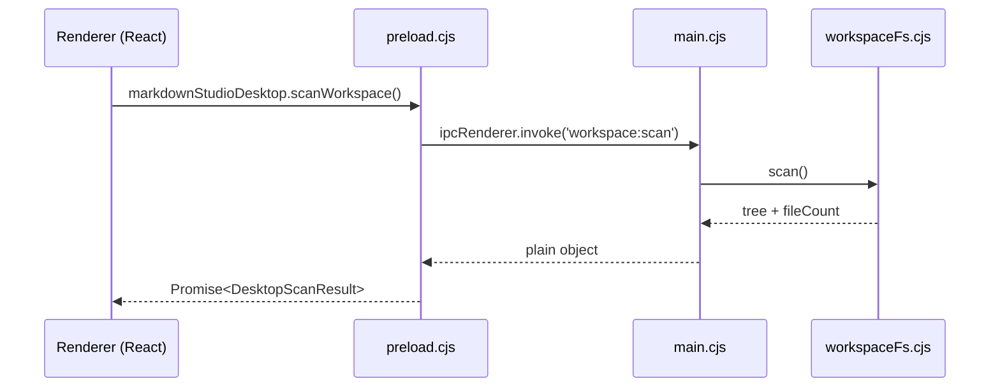
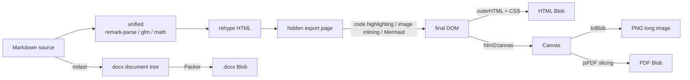

# Markdown studio · Architecture Guide

**English** · [中文](./ARCHITECTURE.zh-CN.md)

- Version: v2.0.0
- Last updated: 2026-11-10
- Tech baseline: React 19 · TypeScript 6 · Vite 8 · CodeMirror 6 · Electron 45
- Desktop delivery: macOS Apple Silicon `.app` / `.dmg` (ad-hoc signed); Windows x64 NSIS installer / portable
- Corresponding PRD: Markdown Editor Product Requirements Document v1.0.0
- Companion doc: [README](../README.md)

---

## 1. Product and Architecture Goals

Markdown studio is a **local-first** Markdown writing workbench. The Markdown source text is the single source of truth; editing, preview, search, export, and file write-back all work around this source text.

Architecture goals:

1. **Editing experience first**: the editor must not drop frames because of live preview, statistics, or file sync.
2. **Maintainable engineering**: UI, state, domain services, and browser infrastructure are layered; business capabilities are unit-testable.
3. **Local-first**: no business backend is introduced. Files are written directly to the local directory the user chooses, and draft recovery is stored only in the browser.
4. **Progressive enhancement**: browsers that support the File System Access API get the full local workspace capability; other browsers can still edit drafts.
5. **Extensible**: adding rendering syntax, export formats, or file system adapters does not require changing the editor core.

Non-goals (v2.0.0):

- Real-time multi-user collaboration, accounts, and cloud sync.
- Breaking out of the browser sandbox to write to arbitrary absolute paths outside the current workspace.
- Server-side layout for PDF, or pixel-by-pixel fidelity for Word.

---

## 2. Tech Stack

| Layer | Technology | Why this choice |
| --- | --- | --- |
| UI | React 19 + TypeScript | Componentization, type constraints, React ecosystem |
| Build | Vite 8 | Fast development, ESM build, on-demand code splitting |
| Desktop container | Electron 45 + electron-builder 26 | Reuses Chromium rendering and the React code, provides native windows and a file system bridge; NSIS installer built cross-platform |
| State | Zustand 5 | Lightweight, fine-grained selectors, suited to high-frequency editor updates |
| Source editor | CodeMirror 6 | Large-file performance, mature Markdown parsing, injectable decorations |
| Markdown rendering | react-markdown 10 + remark/rehype | Component-based React rendering, pluggable syntax |
| Math | remark-math + KaTeX | Standard LaTeX parsing and high-quality typesetting |
| Diagrams | Mermaid 12 (dynamic import) | Flowcharts, sequence diagrams, Gantt charts, etc. |
| Code highlighting | highlight.js (common build) | Lightweight client-side highlighting |
| Local files (Web) | File System Access API + IndexedDB | Read and write a local directory directly after user authorization, with handles persisted |
| Local files (desktop) | Electron IPC + Node `fs/promises` | Native directory dialog, direct read/write of local files, remembers the last workspace |
| Workspace search | Web Worker + in-memory index | Queries do not block the UI; decoupled from 1000+ file workspaces |
| Find-in-file | CodeMirror StateField + findCore | Shares matching semantics with workspace search; in-editor highlight, jump, and replace |
| Find-in-preview | CSS Custom Highlight API + DOM Range | Searches the rendered result directly, without switching back to the edit view or mutating the React DOM |
| PDF / long image | jsPDF + html2canvas (dynamic import) | Pure front-end export, no server dependency |
| DOCX | docx (dynamic import) | Generates Open XML documents in the browser |
| Testing | Vitest + Testing Library | Fast unit tests + lightweight DOM tests |

> Apart from the application itself, there are no network API calls. Exported standalone HTML references KaTeX CDN styles; the application itself runs offline.

---

## 3. Overall Architecture



Design principles:

- **Markdown as the single source of truth**. Preview is a read-only view derived from the source text; no separate rich-text state is stored.
- **Isolation of high-frequency non-React objects**. CodeMirror's `EditorView` lives in a component ref and never enters Zustand; Zustand stores only document content and lightweight metadata.
- **Lazy loading of heavy dependencies**. Mermaid, jsPDF, html2canvas, and docx use dynamic `import()` and stay off the first-screen critical path.
- **Cross-browser capabilities abstracted behind a service layer**. The UI never calls `showDirectoryPicker` directly; `workspaceService` uses the File System Access API on the Web and the native bridge exposed by preload in Electron.
- **Least privilege for the desktop bridge**. The renderer keeps `contextIsolation: true` and `nodeIntegration: false`; it exposes only workspace file operations, and every relative path is re-validated in the main process so it cannot escape the current workspace.

---

## 4. Directory Structure

```text
.
├── src/
│   ├── app/
│   │   ├── workspaceStore.ts       # documents, tabs, workspace snapshot
│   │   ├── preferencesStore.ts     # persisted preferences (Zustand persist)
│   │   └── uiStore.ts              # dialogs, Toast, sidebar, outline
│   ├── components/
│   │   ├── layout/                 # AppBar, StatusBar
│   │   ├── sidebar/                # Sidebar, FileTree, SearchPanel
│   │   ├── search/                 # FindBar: find bar shared by editor / preview
│   │   ├── editor/
│   │   │   ├── MarkdownEditor.tsx  # CodeMirror ↔ React boundary
│   │   │   ├── livePreview.ts      # syntax hiding / live typesetting ViewPlugin
│   │   │   ├── EditorFindWidget.tsx # find-in-file / replace overlay
│   │   │   ├── searchHighlight.ts  # find match / reveal flash decorations
│   │   │   ├── editorTheme.ts      # editor visual theme
│   │   │   └── commands.ts         # Heading, Bold, Table, Math and other commands
│   │   ├── preview/
│   │   │   ├── MarkdownPreview.tsx # react-markdown entry
│   │   │   ├── PreviewFindWidget.tsx # find-in-preview state and navigation
│   │   │   ├── previewSearchHighlight.ts # CSS Custom Highlight API
│   │   │   ├── CodeBlock.tsx       # code highlighting / copy
│   │   │   ├── MermaidDiagram.tsx  # diagrams and error boundary
│   │   │   ├── MarkdownImage.tsx   # local relative asset resolution, path hints, click to view full size
│   │   │   ├── PreviewZoomControls.tsx # preview zoom controls
│   │   │   ├── ImagePreviewPane.tsx # image viewer inside the preview pane: zoom / pan / fit to window
│   │   │   └── OutlinePanel.tsx
│   │   ├── dialogs/                # file, settings, export, insert-image dialogs
│   │   └── ui/                     # base controls
│   ├── domain/                     # document dirty, tree index, image path analysis, zoom computation
│   ├── hooks/
│   │   ├── useWorkspaceActions.ts  # action composition entry
│   │   ├── workspace/
│   │   │   ├── useWorkspaceLifecycle.ts # open / restore / refresh / poll
│   │   │   ├── useDocumentActions.ts    # save / open / paste image
│   │   │   ├── useFileTreeActions.ts    # create / rename / delete / move
│   │   │   └── workspaceHelpers.ts      # flush before switching, snap to workspace
│   │   ├── useSessionPersistence.ts# session draft recovery
│   │   ├── useGlobalHotkeys.ts
│   │   ├── useResolvedTheme.ts
│   │   └── useMediaQuery.ts
│   ├── services/
│   │   ├── file-system/            # Web/desktop dual backends and selection entry
│   │   │   ├── workspaceService.ts # File System Access (Web)
│   │   │   ├── desktopWorkspaceService.ts # Electron bridge client
│   │   │   └── index.ts            # runtime service selection
│   │   ├── search/                 # workspace search, find-in-file / find-in-preview core, Worker client, tests
│   │   ├── markdown/               # stats, outline, Mermaid theme
│   │   ├── export/                 # HTML / PDF / PNG / DOCX
│   │   └── markdown/render        # unified rendering for export
│   ├── workers/search.worker.ts
│   ├── styles/                     # tokens / layout / editor / preview / media / responsive
│   ├── types/                      # domain types and desktop bridge types
│   └── utils/                      # paths, downloads, general utilities
├── electron/
│   ├── main.cjs                    # window, menu, IPC, native dialogs, downloads
│   ├── preload.cjs                 # contextBridge, least-privilege API
│   └── workspaceFs.cjs             # Node fs file system implementation and path validation
├── build/icon.png                  # 1024px app icon source
├── scripts/
│   ├── desktop-dev.mjs             # Vite + Electron dev mode
│   ├── package-macos.sh            # build, ad-hoc signing, ZIP, DMG
│   └── make-dmg.sh                 # generate DMG from .app
├── release/                        # installer artifacts (gitignored)
├── docs/
│   ├── ARCHITECTURE.md
│   ├── ARCHITECTURE.zh-CN.md
│   ├── desktop.png
│   └── *.png                       # README screenshots
├── public/favicon.svg
├── .github/workflows/ci.yml
├── vite.config.ts
├── tsconfig.json
└── package.json
```

---

## 5. Domain Model

### 5.1 Documents

```ts
interface DocumentTab {
  id: string;                 // file:<path> | scratch:<uuid> | sample:<path>
  title: string;
  path: string | null;        // workspace-relative path; null for drafts
  origin: 'workspace' | 'scratch' | 'sample';
  content: string;            // Markdown source text
  savedContent: string;       // content of the most recent write to disk
  dirty: boolean;             // content !== savedContent
  lastModified: number | null;
  createdAt: number;
  cursorLine: number;
  cursorColumn: number;
}
```

All rendering, search, and export read `content`. `savedContent` is used to determine dirty state and to support session recovery.

### 5.2 Workspace

```ts
type TreeNode = FileNode | DirectoryNode;

interface FileNode {
  kind: 'file';
  name: string;
  path: string;
  extension: string;
  size: number;
  lastModified: number;
}

interface DirectoryNode {
  kind: 'directory';
  name: string;
  path: string;
  children: TreeNode[];
}
```

The tree keeps every visible file, but only `.md / .markdown / .mdown / .mkd / .txt` can be opened. `.git`, `node_modules`, hidden files, and the like are skipped by default.

### 5.3 Export Options

```ts
interface ExportOptions {
  format: 'pdf' | 'html' | 'docx' | 'png';
  includeToc: boolean;
  includeHeader: boolean;
  includeFooter: boolean;
  theme: 'light' | 'dark';
}
```

---

## 6. State Management

### 6.1 The Three Zustand Stores

| Store | Lifecycle | Contents |
| --- | --- | --- |
| `workspaceStore` | Current session | Open document tabs, active id, workspace snapshot, sync status, path renames |
| `preferencesStore` | Persisted in `localStorage` | Appearance, view mode, sidebar, sync scrolling, font size, preview zoom, image directory |
| `uiStore` | Current session | Dialogs, Toast, search/file tabs, outline toggle, mobile sidebar, find-in-file toggle, search-hit reveal requests |

Why split them: the editor writes to `workspaceStore` at high frequency, while preferences such as theme and view change rarely; splitting avoids re-rendering unrelated components.

### 6.2 Session Recovery

`useSessionPersistence` writes document sessions to IndexedDB, and localStorage keeps only a synchronous fallback for exit:

```text
IndexedDB  mdstudio.session.v3        # metadata: ids / activeDocumentId / updatedAt
IndexedDB  mdstudio.session.v3:doc:<id>  # one record per document
localStorage mdstudio.session.backup.v1  # written synchronously on pagehide, unsaved documents only
localStorage mdstudio.session.v2 / v1    # legacy formats, migrated automatically on first launch
```

- Writes are debounced by 650 ms; on `pagehide` / `beforeunload` an "unsaved documents only" backup is written synchronously, so a forced quit does not lose the most recent edits.
- On save, only changed documents plus metadata are written based on object reference differences, so every keystroke does not rewrite all documents.
- At startup IndexedDB is read first; if the localStorage backup is newer, documents are merged by document id (backup content overrides documents with the same id).
- The estimated limit is about 32 MB (a rough estimate from the UTF-16 character count of the body text); the real capacity is bounded by the IndexedDB quota, and a failed write raises a prompt.
- On restore `savedContent` is retained; `dirty` is no longer persisted but derived from `content !== savedContent`.
- Workspace handles are persisted separately in IndexedDB; after a refresh, handle permission is restored first, then documents are merged back.

### 6.3 Startup Order



---

## 7. Editor Architecture

### 7.1 CodeMirror Integration Boundary

`MarkdownEditor.tsx` is responsible for:

- Creating the `EditorView` only once per document (the component `key` uses the stable document id; switching tabs rebuilds it, avoiding content bleed across documents).
- Document ids are generated at creation and never change; rename/move only updates `path`, so the editor is not destroyed and undo history and scroll position are not lost.
- Reporting CodeMirror document changes to `workspaceStore.updateDocumentContent`.
- Reporting cursor line and column to `store.updateCursor`.
- Exposing `onReady(view)` to the parent component, so the toolbar runs formatting commands through the same `EditorView`.
- Handling clipboard image pasting, image drag-in, and scroll ratio reporting.
- Keeping the latest callbacks in refs to avoid rebuilding the editor.

### 7.2 Live Syntax Hiding

`livePreview.ts` is a `ViewPlugin` that walks the Lezer Markdown AST with `syntaxTree(state)`:

1. Compute all lines covered by the current selection (active lines).
2. Add line decorations for `ATXHeading1..6`, assigning the corresponding font size and weight.
3. Add content decorations for `StrongEmphasis / Emphasis / Strikethrough / InlineCode / Link`.
4. Hide `HeaderMark / EmphasisMark / StrikethroughMark / CodeMark / QuoteMark` on non-active lines with `Decoration.replace`; adjacent hidden ranges are merged to avoid RangeSet conflicts.
5. Keep syntax marks on active lines and give them a low-contrast style so they can still be edited.
6. Add a line-level background and left border for `Blockquote`, and code-block line styling for `FencedCode`.
7. Rebuild decorations on cursor movement, document changes, and viewport changes.

This is how the project implements the PRD's "marks hide automatically / come back when the cursor enters the line". Marks on the current line are **dimmed rather than fully hidden**, so users can still locate and edit them directly; once the cursor leaves the line they are fully hidden.

### 7.3 Smart Lists and Indentation

- `markdownKeymap` from `@codemirror/lang-markdown` handles Enter and Backspace in Markdown context.
- Tab / Shift+Tab are bound to `indentMore` / `indentLess`.
- Continuation of ordered/unordered/task lists is done by `insertNewlineContinueMarkup`, which automatically inherits indentation, list marker, and task marker, and increments the number.
- Toolbar commands modify the document through CodeMirror transactions, so they enter the undo history.

### 7.4 Formatting Commands

Pure functions in `commands.ts` are separated from EditorView commands:

- `transformHeadingLines` / `transformLinePrefix`: plain-text transformations that can be unit tested directly.
- Headings, bold, italic, strikethrough, inline code, links, images, quotes, lists, task lists, tables, math, and Mermaid blocks.
- The toolbar "Image" button opens `InsertImageDialog`: it analyzes the path live, gives relative-path guidance and workspace image candidates, and on confirmation replaces the selection with the inserted Markdown.
- Selection retention, placeholder text selection, and toggle behavior for paired marks.
- Code blocks, tables, formulas, and Mermaid are padded with blank lines so blocks are not glued into paragraphs.

---

## 8. Markdown Rendering

```text
Markdown source
  → react-markdown
    → remark-gfm / remark-math
    → rehype-katex / rehype-slug
    → React components
       ├─ CodeBlock → highlight.js / Mermaid / copy
       ├─ MarkdownImage → WorkspaceService asset URL
       ├─ table wrapper
       └─ heading DOM → outline
```

- **GFM**: tables, task lists, strikethrough, autolinks.
- **Math**: inline and block formulas are parsed by `remark-math` and rendered by KaTeX; `katex/dist/katex.min.css` is loaded inside the app. Preview and export share `services/markdown/katexOptions.ts`; `strict: 'ignore'` only silences typesetting hints such as "CJK characters in math mode", while genuine syntax errors still emit `katex-error`.
- **Mermaid**: `CodeBlock` detects `language-mermaid`, dynamically imports Mermaid, uses `securityLevel: 'strict'`, with a black-and-white theme. On parse failure it renders an error card plus the source instead of throwing to the page root.
- **Images**: relative paths are resolved by `WorkspaceService.resolveAssetObjectUrl` — a Blob URL on Web, a Data URL from the main process on Desktop (a freshly pasted image reuses its cached Blob URL); pasted images with no connected workspace are stored as inline Data URLs. Paths are uniformly resolved via `resolvePathFrom` (supporting `./`, `../`, and the workspace root `/`); on load failure it shows the actually resolved path, the supported formats, and hints for same-name images.
- **Image viewer**: clicking a preview image, a local image link, or an image file in the file tree opens `ImagePreviewPane` in the content area of the preview panel, covering only the preview pane (the app title bar, sidebar, and editor area stay visible); it supports 5%–800% zoom, Ctrl/⌘ + wheel anchored zoom, drag-to-pan, fit to window, and 1:1. The image format allowlist is PNG / JPEG / GIF / WebP / SVG / AVIF / BMP / ICO / APNG. Opening an image in writing view automatically switches to split view, ensuring the image appears in the preview pane rather than in a modal.
- **Preview zoom**: `previewZoom` is persisted in preferences, range 50%–300%; CSS `zoom` scales the whole typeset page, with the reading column width compensated in reverse.
- **Links**: external links open with `_blank`; relative `*.md` links open the corresponding workspace file via `onOpenPath`, local links pointing at workspace images are handed to the image viewer; `#hash` scrolls within the preview.
- **Security**: ReactMarkdown does not execute raw HTML by default; there is no custom `dangerouslySetInnerHTML` handling of user Markdown (the Mermaid SVG is library output in strict mode). The custom `urlTransform` only additionally allows image Data URLs, while protocols such as `javascript:` are still blocked. External links carry `noopener noreferrer`.

### Outline

After rendering, the `id` and text of `h1..h6` are read from the preview DOM; `rehype-slug` generates stable anchor IDs. The outline panel is for navigation only, not a second copy of document state.

### Statistics Definitions

`services/markdown/stats.ts` computes visible content after stripping Markdown syntax:

- **Word count**: each CJK character counts as 1, and each contiguous run of letters/digits counts as 1 English word.
- **English words**: the number of those contiguous letter/digit runs (excluding Chinese).
- **Character count**: visible characters after removing whitespace, including Chinese and English punctuation; Markdown marks are not included.
- **Paragraphs**: the number of visible text blocks separated by blank lines.
- **Lines**: the number of lines in the raw Markdown source text.
- **Reading time**: `ceil(word count / 300)` minutes; 0 for an empty document.
- The code fences themselves do not count as visible characters, while code content participates in the statistics as text.

The word count, words, characters, paragraphs, and reading time in the status bar all use these rules, and are explained in tooltips.

---

## 9. Local Workspace

### 9.1 Dual File System Backends

`services/file-system/index.ts` selects the implementation at runtime; the UI and state layers depend only on `WorkspaceServiceContract`:

```text
Does window.markdownStudioDesktop exist?
  ├─ yes → DesktopWorkspaceService → preload → Electron IPC → Node fs
  └─ no → WorkspaceService → File System Access API
```

**Web backend**

| Capability | API |
| --- | --- |
| Open directory | `window.showDirectoryPicker({ mode: 'readwrite' })` |
| Permission | `queryPermission` / `requestPermission` |
| Scan | `directory.values()` async iteration, recursively building a sorted tree |
| Read/write | `FileSystemFileHandle.getFile()` / `createWritable()` |
| Create | `getFileHandle(name, { create: true })` / `getDirectoryHandle` |
| Delete | `removeEntry(name, { recursive: true })` |
| Rename/move | copy + delete (the API provides no native move) |
| Images | Write to the configured asset directory, return the relative path and a Blob URL |
| Search index | Batch-read Markdown, cached by `lastModified` |

**Desktop backend**

| Capability | Implementation |
| --- | --- |
| Open directory | Electron `dialog.showOpenDialog({ properties: ['openDirectory'] })` |
| Scan | Main process `fs.readdir` builds the tree recursively, max 6000 files |
| Read/write | `fs.readFile` / `fs.writeFile`; single-file editor limit 10 MB |
| Create/delete | `fs.mkdir` / `fs.rm` |
| Rename/move | `fs.rename` (atomic within the same volume), rejected when the target already exists |
| Images | Main process writes to the asset directory; preview reads it as a Data URL, or uses the freshly pasted Blob URL directly |
| Search index | Main process batch-reads Markdown content, then hands it to the Worker for querying |
| Restore workspace | Path stored in `app.getPath('userData')/last-workspace.json`, restored automatically at startup |

Limits:

- Both backends ignore `.git`, `node_modules`, `dist`, hidden directories, and the like.
- Both desktop and Web only allow access to the current workspace; all IPC paths are validated a second time in the main process, so `../` cannot escape.
- Under the browser security model it is **impossible to write to arbitrary absolute paths outside the current workspace**. The image directory setting accepts workspace-relative paths (e.g. `assets` or `/assets`).

### 9.2 Permissions and Handles (Web)

- After opening a directory, request `readwrite` permission.
- The handle is written to IndexedDB; on the next launch `queryPermission` is called first.
- If the state is `prompt`, no permission request is popped up automatically (browsers require a user gesture); instead a "Reconnect" button is shown in the sidebar.
- When directory permission is revoked, the error surfaces via a Toast or the reconnect prompt instead of crashing.

### 9.3 External Change Sync

`useWorkspaceActions` runs a 5-second poll at the application layer (only while the page is visible and a workspace is connected):

1. **Single-flight**: polling and manual refresh share the same in-flight Promise, so slow scans do not pile up.
2. Rescan the directory tree; on both Web and desktop, file metadata uses bounded concurrency (12 / 16) to avoid serial stat calls.
3. Compute a change signature for the tree (path + `lastModified` + `size`); when the signature is unchanged the original `tree` reference is kept, avoiding file-tree re-renders.
4. For open documents that are **not dirty**, if the on-disk `lastModified` is newer, read the content and sync it into the editor.
5. Documents with unsaved changes are never overwritten by external content.

**Desktop has native file watching wired up**: the main process watches the workspace with `fs.watch(..., { recursive: true })` (FSEvents underneath on macOS) and, after a 250 ms debounce, notifies the renderer via `workspace:changed` to trigger an immediate silent refresh; if watching fails or the platform does not support it, it automatically falls back to 5-second polling. The Web side still uses polling as a cross-browser compromise.

### 9.4 Image Pasting



- **Entry points**: paste and drop both take the first `image/*` item and `preventDefault()` once one exists; the paste path ignores a second paste while the first is still saving (`pasteBusyRef`). `pasteImage(file, documentId)` looks the document up itself (the action is exposed through the `useWorkspaceActions` facade), so an unknown id returns `null` and nothing is inserted; a successful insert replaces the current selection and leaves the cursor after the image.
- **Workspace connected**: `saveImage` writes the blob and returns `{ assetPath, relativePath, objectUrl }`. The inserted Markdown uses `relativePath`, not a hardcoded path; `objectUrl` is only cached in the service for preview reuse. `refreshWorkspace({ silent: true })` then rescans (single-flight with 9.3) so the new asset appears in the tree without a toast. A write failure shows an error toast and inserts nothing.
- **No workspace connected**: the image is embedded as a Data URL, capped at 4 MB (larger files get an "Image too large" toast); nothing is written and no rescan runs.
- **Naming**: the extension comes from the pasted MIME type — `jpg` / `svg` / `gif` / `webp` / `avif` / `bmp`, otherwise `png` — and the name is `image_<timestamp>_<random>.<ext>` under the configured `imageDirectory` (default `assets`). Web sanitizes the directory with `sanitizeAssetDirectory` (a leading `/` is dropped, as are `.`, `..` and empty segments, falling back to `assets`); Desktop only normalizes it in the renderer and validates it again in the main process, which also enforces a known image extension and rejects paths escaping the workspace.

Relative paths are computed against the current document's directory: `getDirName(document.path)` plus `relativePath` (the shared utility used by the Desktop service; the Web service has an equivalent private `relativeTo`). A document at the workspace root gets `assets/image_x.png`, a document in `notes/` gets `../assets/image_x.png`, and a scratch document with no path gets the workspace-root form.

**Preview**: `MarkdownImage` resolves each `src` through `resolveAssetObjectUrl(documentPath, src)`. `http(s):`, `data:` and `blob:` sources pass through unchanged. Everything else is resolved with `resolvePathFrom(documentDir, src)`, so `./`, `../` and a root-anchored `/assets/...` all work. On Web the result is a cached or freshly created Blob URL, falling back to the original `src` when the file is missing; on Desktop the main process returns a Data URL (25 MB read cap, known image extensions only), also falling back to `src`. The same resolution feeds the insert-image dialog and export (`assetDataUrl`).

### 9.5 Electron Desktop Packaging



- **Window**: `BrowserWindow` + `contextIsolation: true`, `nodeIntegration: false`, `sandbox: true`; macOS uses a `hiddenInset` title bar, and the AppBar is made the window drag region.
- **Menu**: macOS app menu, File / Edit / View / Window; `⌘O` triggers the renderer's open-folder action via IPC.
- **Downloads**: intercept `will-download` and use a native "Save As" dialog to choose the export directory, avoiding silent downloads.
- **External links**: intercept `window.open` and navigation; HTTP(S) links are handed to the system browser.
- **Security**: preload exposes only a minimal API such as `chooseWorkspace / scan / read / write / rename / remove / image`; the main process accepts only relative paths and runs `realpath` validation on the target (or its nearest existing ancestor) before every read and write, preventing escapes from the workspace through symbolic links.
- **IPC boundary**: only calls from the main frame of the main window are accepted; arguments are type-validated; production builds inject a CSP (`script-src 'self'`, no remote scripts), while dev mode does not inject one so HMR keeps working.
- **Navigation and permissions**: `will-navigate` denies everything by default, with `http(s)` handed to the system browser; `setPermissionRequestHandler` denies by default and only allows clipboard writes; a single-instance lock is enabled so two instances cannot race over `last-workspace.json`.
- **Downloads**: pause the download item first, asynchronously show the native "Save As", then set the path and resume after confirmation, avoiding blocking the main process.
- **Persistence**: the last workspace path is stored in `userData/last-workspace.json`; document sessions use renderer IndexedDB, with a localStorage backup written on exit.
- **Packaging**: electron-builder produces `.app` / Windows directories; the app ships no business node_modules (the renderer is bundled), and the asar is about 8 MB.
- **macOS**: after ad-hoc signing, `ditto` produces the ZIP; `hdiutil` produces the DMG.
- **Windows**: the same Electron main process and preload, using `electron-builder --win nsis portable --x64` to produce the NSIS installer and portable EXE. The Apple Silicon build machine uses the arm64 `makensis` via `build.toolsets.nsis: "1.2.1"`, avoiding compatibility problems of older x86_64 binaries on Apple Silicon. Windows EXEs are not signed.

Desktop installers:

- `release/Markdown-studio-2.0.0-arm64.dmg` (129 MB)
- `release/Markdown-studio-2.0.0-arm64.zip` (117 MB)
- `release/mac-arm64/Markdown studio.app`
- `release/Markdown-studio-2.0.0-x64-setup.exe` (118 MB, NSIS installer)
- `release/Markdown-studio-2.0.0-x64-portable.exe` (107 MB, portable)

macOS has been launched from the mounted DMG, verifying the native workspace, saving, image pasting, search, and last-workspace restore; the ad-hoc signature has no Apple Developer ID notarization, so the first launch may require right-click → "Open". The Windows package has passed a 7-Zip archive test and the embedded `MarkdownStudio.exe` / `app.asar` were verified, but the current build machine cannot run Windows, so no on-device launch verification has been performed yet.

---

## 10. Search System

### 10.1 Index and Query

- Once a workspace is connected, `SearchPanel` pre-builds the index in the background (when the file count is ≤ 2000) and displays progress.
- **The index lives in the Worker**: the main thread sends the full index once via `set-index`; it is rebuilt and re-sent only when the directory-tree signature changes.
- Open documents (including unsaved content) are synced with incremental `update-index` patches; when a document closes, the on-disk content is backfilled. Each query sends only `{ query, useRegex, caseSensitive, maxResults }` and no longer copies the entire workspace text.
- Queries are handed to `search.worker.ts`; the main thread only handles result rendering.
- Clicking a hit opens the corresponding file and reveals the line and column in the editor through `uiStore.revealRequest`; the editor briefly flashes a highlight on that hit.

```text
set-index(files[]) ──postMessage──▶ Worker (baseline index)
update-index(changed[]) ──────────▶ Worker (incremental override for open documents)
reset-overrides(paths[]) ─────────▶ Worker (restore baseline content when a document closes)
matching-paths(query) ────────────▶ Worker (file list for "Replace All", not limited by maxResults)
{ query, options } ───────────────▶ Worker
                                     ├─ compile regex / escape plain strings
                                     ├─ enumerate all hits file by file, line by line
                                     ├─ build 280-character context snippets
                                     └─ truncate to maxResults
results[] ◀──postMessage────────────┘
```

The renderer keeps only the path list and no longer keeps a copy of the workspace text; Replace All obtains the complete file list through `matching-paths`, then reads and replaces each file one by one.

### 10.2 Replace

- **Replace All**: re-read the latest content from disk, build a new global RegExp, and write back file by file; dirty open documents are skipped, and the number skipped is stated in the result message.
- **Replace one**: locate by the hit's line and column, read the latest file content, replace the single occurrence, then refresh the results.
- After replacement, the file tree and open document contents are refreshed so the UI and disk state do not diverge.
- The sample workspace is read-only; replace buttons are disabled with a hint to open a local folder.

### 10.3 Find and Replace Inside the Editor

- `⌘F` / `Ctrl F` opens the floating find bar at the top-right of the editor; when there is a selection it is pre-filled into the query.
- `findCore.ts` shares matching semantics with workspace search: plain text / regex, case sensitivity, whole word, returning UTF-16 offsets that CodeMirror can use directly.
- `findMatches` enumerates all hits and skips zero-width regex matches; `EditorFindWidget` renders all hits and the current hit through the StateField in `searchHighlight`, and scrolls to the current hit; hits use a light green background, with the current hit shown darker.
- `⌘⌥F` / `Ctrl H` / `Ctrl Alt F` expands replace. In plain mode replacement stays literal; in regex mode `$1`, `$<name>`, and `$&` capture groups are supported. Replacement is written back through a CodeMirror transaction, automatically marks the document dirty, and enters the undo history.
- `Enter` / `Shift Enter`, `F3` / `Shift F3` cycle through hits; `Esc` closes and clears highlights.
- `EditorFindWidget` and `PreviewFindWidget` share `FindBar` and the query state in `uiStore`; switching between views keeps the query and options.

### 10.4 Find Inside the Preview

- In preview view `⌘F` no longer switches views; `PreviewFindWidget` searches directly in the current rendered result and offers only find, previous / next, and a count; no replace entry is shown.
- `previewSearch.ts` flattens the visible text nodes of `.markdown-body` into an index with offsets, inserting separators between block-level elements so phrase searches do not match across paragraphs; the resulting offsets are then mapped back to DOM `Range`s.
- Highlighting uses the CSS Custom Highlight API (`::highlight(md-preview-search)` / `::highlight(md-preview-search-active)`), with light green / darker light green colors, without mutating the React-rendered DOM; noise nodes such as code block headers, duplicated MathML content, and Mermaid SVGs are excluded.
- Preview DOM changes (async diagrams, formulas, external file refreshes) trigger a rebuild via `MutationObserver`; `Range.getBoundingClientRect()` scrolls the current hit into the preview's visible area.

### 10.5 Performance Boundaries

- The first index build reads from disk and depends on file count and disk speed; the UI shows progress.
- The query phase scans the in-memory index linearly in the Worker. At the scale of 1000 files of tens of KB each, queries are millisecond-level; the first index build is not guaranteed to finish within 1 second.
- This design prioritizes **keeping queries off the main thread**, and uses background prefetching to shorten the user's wait for the first search.

---

## 11. Export System



### 11.1 HTML

- Use unified to generate HTML directly, avoiding dependence on the visual state of the preview DOM.
- Perform code highlighting, Mermaid SVG rendering, and relative image inlining in an off-screen container.
- Export styles are composed of `tokens.css`, `preview.css`, and the export page styles.
- Math styles are referenced through the KaTeX CDN; Mermaid SVGs are already inlined.

### 11.2 PDF / PNG

- Create a hidden `.export-page` with the same width as A4 (794px), using black/white variables according to the current theme.
- `html2canvas` captures at 2x scale.
- PDF uses jsPDF to slice by A4 content height; page numbers are drawn when `includeFooter` is set.
- This is a "visual snapshot" PDF: highly consistent with the editor preview, but pagination slices by pixels, so long tables/code blocks may be cut at page boundaries. Production-grade print layout can be replaced with native printing or server-side rendering.

### 11.3 DOCX

- Use `docx` to map mdast to Word elements:
  - Heading → `HeadingLevel`
  - Paragraph/quote/list → Paragraph with indentation, borders, and bullets
  - Table → Table / TableRow / TableCell
  - Code → dark background, monospace font
  - TOC → Word `TableOfContents` field
- Math is preserved as `$...$` / `$$...$$` text, and Mermaid is preserved as code blocks; no visualization of graphics/formulas inside Word is promised. This is consistent with the positioning of "exporting semantic content".
- Headers, footers, and page numbers are generated by docx Header/Footer.

### 11.4 Security

- Titles and content text of the exported HTML are escaped by remark-rehype; raw HTML is not enabled.
- Mermaid `securityLevel: 'strict'`.
- External image URLs are kept as-is; workspace-relative images are inlined as Data URLs so the exported file is self-contained.
- The whole export process happens in browser memory and never goes through a server.

---

## 12. Data and Privacy

| Data | Location | Notes |
| --- | --- | --- |
| Document body | The user's local Markdown files | Written to disk only on explicit save/export |
| Session draft | Browser IndexedDB (`mdstudio.session.v3` metadata + one record per document) | Restored on refresh; ~32 MB estimated limit; a synchronous localStorage backup is also written on exit |
| Preferences | Browser `localStorage` | Theme, font size, view, sync, preview zoom, image directory |
| Workspace handle | IndexedDB (Web) | Stores only the browser authorization handle, not file copies |
| Last workspace | `userData/last-workspace.json` (desktop) | Stores only the directory path, used for startup restore |
| Image cache | In-memory Object URL / Data URL | Released when the page closes |
| Search index | Memory | Not persisted |

There is no business server, telemetry, account, or cloud upload. External images or links are only fetched by the browser from the corresponding URL when the user actively inserts them and they are rendered.

---

## 13. Performance Strategy and Measurements

### 13.1 Strategy

- CodeMirror renders only the lines in the viewport, so a large document does not create 50,000 DOM nodes.
- Live decorations are rebuilt only on `docChanged / selectionSet / viewportChanged`, and traverse only the syntax-tree window of "viewport + selection lines", so long documents no longer walk the whole text on every cursor move.
- Preview uses `useDeferredValue` + `React.memo`, so every keystroke does not synchronously block the preview.
- `PreviewPane` (react-markdown / KaTeX / Mermaid) and the export pipeline (unified / highlight.js / docx) are all loaded dynamically on demand; the first screen contains only React, CodeMirror, and the editor shell.
- Statistics are based on `useDeferredValue` and do not perform expensive DOM queries on the input path.
- Mermaid, jsPDF, html2canvas, and docx are all dynamically imported on demand.
- Search runs in a Worker; the main thread is only responsible for rendering hits.
- External sync polling scans metadata only, and open documents are re-read only when `lastModified` changes.

### 13.2 Measured Data

Environment: macOS, Chrome headless (desktop size 1440×900), local production preview (`vite preview`), 2026-11-09.

> The table below shows historical measurements for 2.0.0. The 2026-11-10 build has reduced first-screen JS from 1,514.81 kB (gzip 494.85 kB) to an entry of 118.27 kB (gzip 36.93 kB), about 288 kB gzip in total for the first screen; interaction latency has not been re-measured, and a baseline round should be added before release.

| Metric | Result |
| --- | --- |
| First interactive to editor | ~193 ms |
| First interactive to preview | ~207 ms |
| Asset transfer (local) | ~747 KB |
| ~65k-character document load | ~60 ms |
| Frames in 1 second of scrolling | 60 frames |
| Average frame interval / max frame interval | 16.5 ms / 16.8 ms |
| Long tasks during continuous typing | 0 (PerformanceObserver) |
| Search (5-file sample workspace) | ~1 ms (timed inside the Worker) |

> These numbers were measured on a local development machine and do not represent network deployments or low-end devices. The cold-start goal of < 1.5 s is met on the current build; search timings exclude the first disk index build.

---

## 14. Engineering Quality

### 14.1 Scripts

| Command | What it does |
| --- | --- |
| `npm run dev` | Development server |
| `npm run build` | `tsc --noEmit` + Vite build |
| `npm run typecheck` | Strict TypeScript check |
| `npm run lint` | ESLint 10 + TypeScript + React Hooks |
| `npm test` | Vitest |
| `npm run ci` | lint + typecheck + test + build |
| `npm run desktop:dev` | Starts Vite and the Electron dev window |
| `npm run desktop` | Builds then starts Electron (loads local `dist`) |
| `npm run desktop:package` | Builds `.app`, ad-hoc signing, ZIP, DMG |
| `npm run dist:win` | Builds the Windows x64 NSIS installer and portable |

### 14.2 Test Coverage

Currently **96 tests**:

- Workspace store: stable ids, derived dirty, dirty collection before switching, de-duplication of concurrent opens, invalid paths becoming offline drafts, skipping updates when the scan signature is unchanged.
- Workspace actions: flush ordering before switching, aborting a switch on write failure, rejecting switches when not connected, saving by id, resolving image paths by the originating document, routing image files to the viewer.
- Workspace tree index: path index, file/directory lookup, Markdown / image file classification, signature changing with metadata.
- Image paths and formats: `./` / `../` / root path resolution, same-name image candidates, external and Data URLs, Markdown destination escaping, preview URL protocol allowlist.
- Zoom computation: preview zoom range/step/percentage, image viewer zoom and fit-to-window.
- Session persistence: legacy format migration, field normalization, UTF-8 byte accounting, computing the write set from per-document reference differences.
- Search index: baseline index, unsaved overrides, override reset, unlimited matching paths, regex/case sensitivity and invalid regex.
- Markdown statistics rules: Chinese, English, paragraphs, empty documents.
- Markdown outline and slug: duplicate headings, headings inside code blocks, CJK.
- Editor commands: headings, bold, lists, task lists, indent conversion.
- Workspace search core: plain text, regex, case sensitivity, very long line context, invalid regex, multiple hits on a single line, result truncation.
- Find-in-file core: plain text, case sensitivity, whole word, regex, zero-width matches, replacement and capture groups.
- Find-in-preview core: DOM text index, block-level separators, mapping hits to Ranges, filtering noise nodes.
- File system service (Web): uses an in-memory Fake FileSystemHandle to cover open/scan/read/write/create/rename/delete/image, avoiding dependence on real directories.
- File system service (Electron): verifies Node-native scanning, reading/writing, CRUD, images, search reads, path escapes, and symlink escape protection in a temporary directory.
- React base components: `SegmentedControl` ARIA and change callbacks.

### 14.3 CI

`.github/workflows/ci.yml` runs on Node 22 / Ubuntu:

```text
npm ci (skip the Electron binary download) → lint → typecheck → test → build
```

CI covers the Web build and the 96 tests; desktop installers are produced on a macOS build machine via `npm run desktop:package` (macOS) or `npm run dist:win` (Windows).

### 14.4 Manual Acceptance

- Chrome headless verification: split view, writing, preview, mobile, dark mode, search, settings, export.
- Chrome headless verification of the image chain: preview zoom (buttons / Ctrl+wheel / persistence), insert-image path hints and same-name candidates, image files in the file tree / Markdown images / image links opening inside the preview pane, viewer boundaries and Esc to return, image viewer buttons and wheel zoom, filling the main area when there is no document, mobile layout.
- Verification with an in-memory Fake FileSystemHandle: opening a workspace, file tree, external-change sync, create, rename, delete, drag-to-move, image pasting, Replace All; plus in-memory image files to verify local Markdown images, SVG preview, insert-dialog thumbnails, and relative-path insertion.
- Verify actual downloads of PDF, PNG, HTML, and DOCX; DOCX is checked with `python-docx` for headings, tables, headers/footers, and paragraph structure.
- The packaged Electron app is verified via remote debugging: native workspace scanning, file save to disk, image paste to disk, global search, last-workspace restore; and it is verified by launching from the mounted DMG.
- `codesign --verify` passes; `hdiutil verify` validates the DMG; the `.app` extracted from the ZIP launches.
- The Windows installer and portable build pass the 7-Zip `t` integrity test; `MarkdownStudio.exe` inside the NSIS archive is confirmed to be an x86-64 PE, and `resources/app.asar` contains `electron/` and `dist/`. Because the build machine is macOS, no on-device Windows launch/install regression was performed.

---

## 15. PRD Acceptance Mapping

Legend: ✅ implemented and verified; ◐ implemented but with a browser/product boundary; — out of scope for this release.

| PRD | Item | Status | Implementation notes |
| --- | --- | --- | --- |
| 1.1 | Live rendering, mark hiding/restoration | ✅ | `livePreview.ts`; inactive lines hidden, active lines dimmed while staying editable |
| 1.1 AC1 | Instant heading styling | ✅ | `ATXHeading` line decorations + `HeaderMark` hiding |
| 1.1 AC2 | Marks restored when the cursor returns to a heading line | ✅ | decorations rebuilt on selection change |
| 1.1 AC3 | No flicker / cursor misplacement when switching | ✅ | CodeMirror's native decoration mechanism; the editor is not rebuilt |
| 1.2 AC1 | Ordered list continuation | ✅ | `markdownKeymap` / `insertNewlineContinueMarkup` |
| 1.2 AC2 | Task list continuation | ✅ | Same as above, keeping `[ ]` |
| 1.2 AC3 | Tab / Shift+Tab levels | ✅ | `indentMore` / `indentLess` |
| 2.1 AC1 | Inline LaTeX | ✅ | remark-math + KaTeX |
| 2.1 AC2 | Block LaTeX | ✅ | `$$...$$` + KaTeX display |
| 2.2 AC1 | Live Mermaid vector diagrams | ✅ | Dynamic Mermaid, black-and-white theme |
| 2.2 AC2 | Mermaid error hints | ✅ | Error card + source, no crash |
| 2.3 AC1 | Pasted screenshots written to assets | ✅ | Verified with Fake FS and the browser path |
| 2.3 AC2 | Image save path setting | ◐ | Supports workspace-relative paths/`/assets`; the browser security model does not allow writing to arbitrary absolute paths outside the workspace |
| 2.3 AC3 (extension) | Path hints when inserting images | ✅ | Resolves relative / root paths, hints same-name images, candidate relative paths, and formats |
| 2.3 AC4 (extension) | Preview of image-format files | ✅ | PNG / JPEG / GIF / WebP / SVG / AVIF / BMP / ICO / APNG; file tree, local image links, and preview images all open the viewer inside the preview pane |
| 1.3 AC1 (extension) | Preview zoom | ✅ | 50%–300%, persisted in preferences, `⌘ / Ctrl` + wheel |
| 3.1 AC1 | Open files from the file tree | ✅ | File Tree + tabs |
| 3.1 AC2 | Create file/folder (shortcut/context menu) | ✅ | Sidebar buttons, context menu, `⇧⌘N` |
| 3.1 AC3 | External file change sync | ◐ | 5 s polling + auto-refresh of non-dirty documents; not an OS-level watcher |
| 3.2 AC1 | 1000+ file global search | ◐ | Background index + Worker; the first index build depends on disk, later queries are millisecond-level |
| 3.2 AC2 | Replace All / replace one | ✅ | Skips dirty documents and says so |
| 3.2 AC3 (extension) | Find / replace / match highlighting in file | ✅ | `⌘F` / `⌘⌥F`; `findCore` + CodeMirror StateField |
| 3.2 AC4 (extension) | Find / highlight in preview without switching views | ✅ | CSS Custom Highlight API + DOM Range; find only |
| 4.1 AC1 | Consistent PDF layout | ◐ | High-fidelity html2canvas snapshot, but pagination slices by pixels |
| 4.1 AC2 | Header/footer/TOC options | ✅ | HTML/PDF/PNG + DOCX fields |
| 5.1 AC1 | Chinese/English/character/paragraph statistics | ✅ | `stats.ts`, rules explained in the status bar tooltip and in the docs |
| 5.1 AC2 | Live updates without jank | ✅ | `useDeferredValue` + pure-function counting |
| NFR | Cold start < 1.5s | ✅ | 193 ms to editor on local production preview |
| NFR | 60 FPS scrolling at 50k characters | ✅ | CodeMirror virtualization; measured 60 frames/second |
| NFR | Windows/macOS/Linux | ◐ | macOS Apple Silicon and Windows x64 installers released; the Windows package lacks on-device regression; the Linux desktop package is not built |
| NFR | Purely local data | ✅ | No business backend; sessions are also written only to browser-local storage |

---

## 16. Known Limitations and Roadmap

### 16.1 Known Limitations

1. **Distribution signing**: the current `.app`/`.dmg` uses ad-hoc signing with no Apple Developer ID or notarization; the first launch may be blocked by Gatekeeper and require right-click → "Open". Public distribution requires a developer certificate, `notarytool`, and stapling.
2. **macOS Apple Silicon only**: the macOS installer is arm64; Intel Macs need an x64/Universal build. The Windows package is x64.
3. **Windows package not verified on device / unsigned**: it has been cross-built on macOS and validated by archive structure, but install and launch regression has not been run on Windows 10/11; there is also no Windows code-signing certificate, so SmartScreen will show an unknown publisher warning.
4. **Absolute image paths**: the desktop native bridge still writes assets into the current workspace and does not allow arbitrary absolute paths outside it; this is an intentional security boundary.
5. **Web browser directory capability**: the File System Access API is fully available only in Chromium-based browsers; Safari/Firefox only offer sample/draft editing.
6. **External sync is polling**: 5 seconds by default, not real-time file watching; scanning and syncing large directories incurs periodic overhead.
7. **First search index**: depends on disk I/O; the UI shows progress, and the queries themselves run in the Worker.
8. **PDF pagination**: pixel slicing may cut through long tables/code blocks; header, footer, and TOC support is implemented.
9. **Image format boundaries**: image preview depends on Chromium's decoding capability, with an allowlist of PNG / JPEG / GIF / WebP / SVG / AVIF / BMP / ICO / APNG; formats such as HEIC and TIFF are not supported yet. On desktop, assets larger than 25 MB are not read as Data URLs.
9. **DOCX rich content**: Mermaid is kept as code and math as text; Mermaid/KaTeX rendering is not performed inside Word.
10. **Edit history when switching tabs**: each document uses a new CodeMirror instance, so undo history is not preserved across tabs (consistent with the session behavior of most editors).
11. **Math fonts in exported HTML**: depends on the KaTeX CDN; viewing the HTML offline may require font fallbacks for formulas.
12. **Session snapshot size**: the IndexedDB limit is 32 MB (in UTF-8 bytes); the localStorage fallback backup on exit is still bounded by browser quota.
13. **No backend/collaboration/cloud sync**: this is the product positioning, not a defect.

### 16.2 Roadmap

- **Windows on-device regression and signing**: verify install, upgrade, uninstall, file read/write, and PDF export on Windows 11 x64/ARM64, and configure an Authenticode certificate.
- **Linux desktop build**: produce AppImage/deb in the CI matrix.
- **Developer ID signing and notarization**: for official distribution, auto-update, and Gatekeeper-silent launch.
- **Native file watching**: replace 5-second polling with FSEvents/chokidar.
- **Incremental search index**: directory-level mtime + file-level cache to avoid rebuilding the full index.
- **Native PDF pagination**: replace canvas slicing with Chromium Print or server-side layout.
- **Document history**: local version snapshots and diffs.
- **Optional sync layer**: keep the core local-first, adding plugin-based remote sync on top.
- **More syntax**: footnotes, definition lists, Front Matter UI, PlantUML.

---

## 17. Key Architecture Decisions (ADR Summary)

| Decision | Choice | Rationale |
| --- | --- | --- |
| Editor core | CodeMirror 6 instead of a full WYSIWYG framework | Keeps the Markdown source text, performs well on very large documents, controllable decoration API; live preview delivers "semi-WYSIWYG" |
| Preview rendering | react-markdown + unified | Natural fit with React component boundaries; mature KaTeX/GFM ecosystem |
| State | Zustand, rather than stuffing all editor state into React Context | Fine-grained selectors under high-frequency updates; EditorView stays out of React state |
| File system | File System Access API on the Web; Electron IPC on desktop | The same React code covers both browser and native desktop; desktop uses Node fs and native dialogs directly |
| Search | Web Worker | Queries over 1000+ files must not block typing |
| Export | Browser-side dynamic dependencies | Zero server, data never leaves the device; Mermaid/PDF/DOCX dependencies are all split into chunks |
| Theme | CSS Custom Properties | Black-and-white themes, export, and component styles share the same set of tokens |
| Session | IndexedDB snapshot + synchronous localStorage backup + handle/path config | Large documents are no longer limited by the 4–5 MB localStorage limit; the exit fallback guarantees recovery after a forced quit |

---

## 18. Build and Deployment

```bash
# Development
npm run dev

# Quality gate
npm run ci

# Production build
npm run build
npm run preview
```

The Web artifact is a static site in `dist/` with no routing, deployable to any static host. `base` is set to `./`, so it works both at a site root path and when loaded via `file://` in Electron.

Desktop build:

```bash
# Development (Vite + Electron window)
npm run desktop:dev

# Package: .app + .zip + .dmg (ad-hoc signed)
npm run desktop:package

# Windows x64: NSIS installer + portable
npm run dist:win
```

Artifacts are in `release/`:

- macOS: `Markdown-studio-2.0.0-arm64.dmg`, `Markdown-studio-2.0.0-arm64.zip`, `release/mac-arm64/Markdown studio.app`
- Windows: `Markdown-studio-2.0.0-x64-setup.exe`, `Markdown-studio-2.0.0-x64-portable.exe`

Before official public distribution, macOS should be re-signed and notarized with an Apple Developer ID; Windows should be signed with an Authenticode certificate and go through on-device regression.

Production recommendations:

- Use HTTPS (the File System Access API is available only in secure contexts; `localhost` is the exception).
- Do not upload user Markdown to a CDN or logs.
- If embedding in an iframe, allow the `clipboard-read` / `clipboard-write` and directory-picker permission policies.
- Desktop installers must keep `contextIsolation`; do not expose `fs` or arbitrary IPC in preload.

---

## 19. Changelog

| Version | Date | Description |
| --- | --- | --- |
| 2.0.0+ | 2026-11-10 | Architecture optimization (source changes, installers remain 2.0.0): stable document ids, flush before switching workspaces, per-document IndexedDB sessions, resident Worker index and matching-paths protocol, desktop native file watching, viewport-level decorations, parallel scanning, Electron security hardening and build chunking; see the [optimization checklist](./OPTIMIZATION-CHECKLIST.md) |
| 2.0.0 | 2026-11-09 | React + TypeScript engineering rewrite; macOS and Windows Electron desktop apps; local workspace, search, export, LaTeX, Mermaid, session recovery |
| 1.x | 2026-11-09 | Early static prototype (archived, no longer in the current source tree) |
