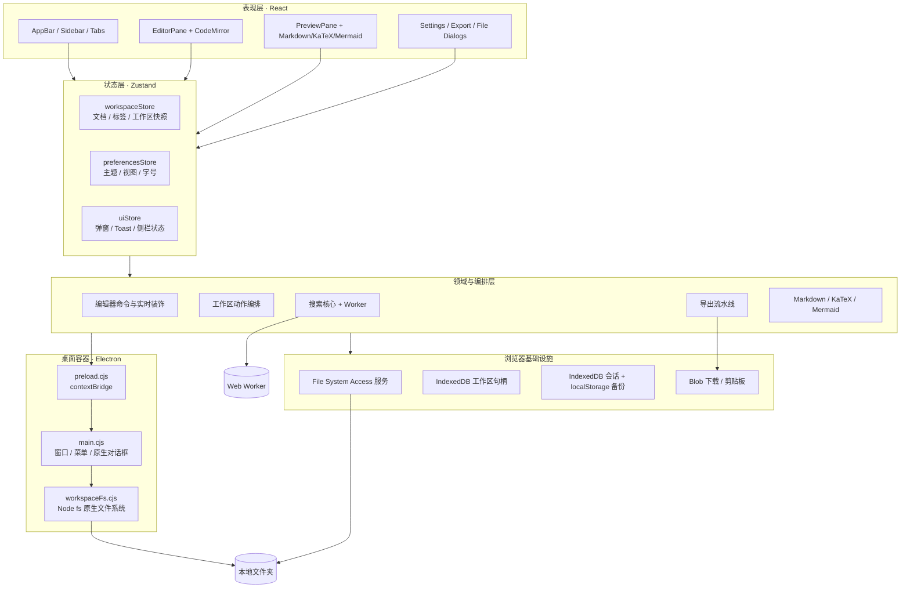
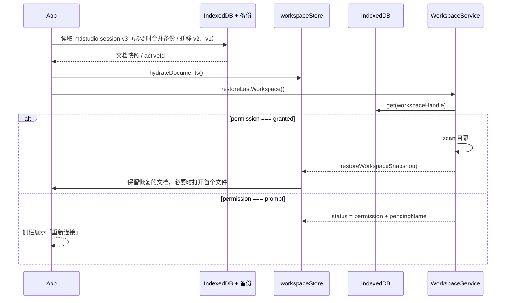
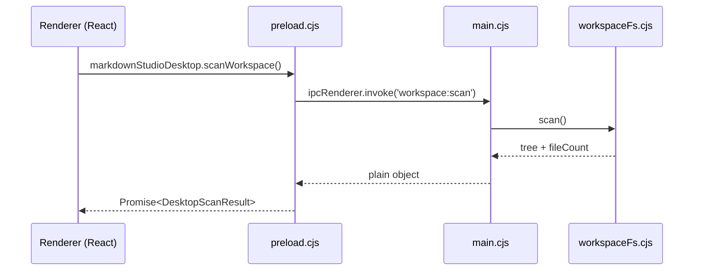
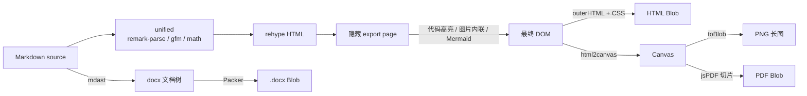

# Markdown studio · 项目架构文档

- 版本：v2.0.0
- 更新时间：2026-11-10
- 技术基线：React 19 · TypeScript 6 · Vite 8 · CodeMirror 6 · Electron 45
- 桌面交付：macOS Apple Silicon `.app` / `.dmg`（ad-hoc 签名）；Windows x64 NSIS 安装版 / 便携版
- 对应 PRD：Markdown 编辑器产品需求文档 v1.0.0
- 配套说明：[README](../README.md)

---

## 1. 产品与架构目标

Markdown studio 是一个 **local-first（本地优先）** 的 Markdown 写作工作台。Markdown 源文本是唯一事实来源；编辑、预览、搜索、导出、文件写回都围绕这份源文本工作。

架构目标：

1. **编辑体验优先**：编辑器不能因为实时预览、统计或文件同步而掉帧。
2. **工程可维护**：UI、状态、领域服务、浏览器基础设施分层；业务能力可单测。
3. **本地优先**：不引入业务后端。文件直接写入用户选择的本地目录，草稿恢复只保存在浏览器本地。
4. **渐进增强**：支持 File System Access API 的浏览器获得完整本地工作区能力；其他浏览器仍可编辑草稿。
5. **可扩展**：新增渲染语法、导出格式或文件系统适配器时，不需要改动编辑器核心。

非目标（v2.0.0）：

- 实时多人协作、账号体系和云端同步。
- 在浏览器沙箱内突破权限写入当前工作区以外的任意绝对路径。
- 对 PDF 做服务端排版或对 Word 做逐像素还原。

---

## 2. 技术栈

| 层 | 技术 | 选择原因 |
| --- | --- | --- |
| UI | React 19 + TypeScript | 组件化、类型约束、React 生态 |
| 构建 | Vite 8 | 快速开发、ESM 构建、按需代码分割 |
| 桌面容器 | Electron 45 + electron-builder 26 | 复用 Chromium 渲染与 React 代码，提供原生窗口和文件系统桥接；NSIS 安装器跨平台构建 |
| 状态 | Zustand 5 | 轻量、selector 粒度细、适合编辑器高频更新 |
| 源码编辑器 | CodeMirror 6 | 大文件性能、成熟的 Markdown 解析、可注入装饰 |
| Markdown 渲染 | react-markdown 10 + remark/rehype | React 组件化渲染、可插拔语法 |
| 数学 | remark-math + KaTeX | 标准 LaTeX 解析与高质量排版 |
| 图表 | Mermaid 12（动态导入） | 流程图、时序图、甘特图等 |
| 代码高亮 | highlight.js（common build） | 客户端轻量高亮 |
| 本地文件（Web） | File System Access API + IndexedDB | 用户授权后直接读写本地目录，句柄持久化 |
| 本地文件（桌面） | Electron IPC + Node `fs/promises` | 原生目录对话框、直接读写本地文件、记住上次工作区 |
| 工作区搜索 | Web Worker + 内存索引 | 查询不阻塞 UI；与 1000+ 文件工作区解耦 |
| 文件内查找 | CodeMirror StateField + findCore | 与工作区搜索共享匹配语义，编辑器内高亮、跳转与替换 |
| 预览内查找 | CSS Custom Highlight API + DOM Range | 直接搜索渲染结果，不切回编辑视图、不修改 React DOM |
| PDF / 长图 | jsPDF + html2canvas（动态导入） | 纯前端导出，不依赖服务端 |
| DOCX | docx（动态导入） | 浏览器生成 Open XML 文档 |
| 测试 | Vitest + Testing Library | 快速单测 + 轻量 DOM 测试 |

> 除应用自身外，没有网络 API 调用。导出的独立 HTML 会引用 KaTeX CDN 样式；应用运行本身离线可用。

---

## 3. 总体架构



设计原则：

- **Markdown 为单一事实来源**。预览是从源文本派生的只读视图，不保存一份富文本状态。
- **非 React 高频对象隔离**。CodeMirror 的 `EditorView` 存在组件 ref 中，不进入 Zustand；Zustand 只保存文档内容和轻量元数据。
- **重型依赖延迟加载**。Mermaid、jsPDF、html2canvas、docx 使用动态 `import()`，不进入首屏关键路径。
- **跨浏览器能力通过服务层抽象**。UI 不直接调用 `showDirectoryPicker`；`workspaceService` 在 Web 下使用 File System Access API，在 Electron 下使用 preload 暴露的原生桥。
- **桌面桥最小权限**。渲染进程保持 `contextIsolation: true`、`nodeIntegration: false`；只暴露工作区文件操作，所有相对路径在主进程再次校验，不能逃逸当前工作区。

---

## 4. 目录结构

```text
.
├── src/
│   ├── app/
│   │   ├── workspaceStore.ts       # 文档、标签、工作区快照
│   │   ├── preferencesStore.ts     # 持久化偏好（Zustand persist）
│   │   └── uiStore.ts              # 弹窗、Toast、侧栏、大纲
│   ├── components/
│   │   ├── layout/                 # AppBar、StatusBar
│   │   ├── sidebar/                # Sidebar、FileTree、SearchPanel
│   │   ├── search/                 # FindBar：编辑器 / 预览共用的查找条
│   │   ├── editor/
│   │   │   ├── MarkdownEditor.tsx  # CodeMirror ↔ React 边界
│   │   │   ├── livePreview.ts      # 语法隐藏 / 实时排版 ViewPlugin
│   │   │   ├── EditorFindWidget.tsx # 文件内查找 / 替换浮层
│   │   │   ├── searchHighlight.ts  # 查找命中 / 定位闪烁装饰
│   │   │   ├── editorTheme.ts      # 编辑器视觉主题
│   │   │   └── commands.ts         # Headings、Bold、Table、Math 等命令
│   │   ├── preview/
│   │   │   ├── MarkdownPreview.tsx # react-markdown 入口
│   │   │   ├── PreviewFindWidget.tsx # 预览内查找状态与导航
│   │   │   ├── previewSearchHighlight.ts # CSS Custom Highlight API
│   │   │   ├── CodeBlock.tsx       # 代码高亮 / 复制
│   │   │   ├── MermaidDiagram.tsx  # 图表与错误边界
│   │   │   ├── MarkdownImage.tsx   # 本地相对资源解析、路径提示、点击查看大图
│   │   │   ├── PreviewZoomControls.tsx # 预览缩放控件
│   │   │   ├── ImagePreviewPane.tsx # 预览区内的图片查看器：缩放 / 拖拽 / 适应窗口
│   │   │   └── OutlinePanel.tsx
│   │   ├── dialogs/                # 文件、设置、导出、插入图片对话框
│   │   └── ui/                     # 基础控件
│   ├── domain/                     # 文档 dirty、树索引、图片路径分析、缩放计算
│   ├── hooks/
│   │   ├── useWorkspaceActions.ts  # 动作组合入口
│   │   ├── workspace/
│   │   │   ├── useWorkspaceLifecycle.ts # 打开 / 恢复 / 刷新 / 轮询
│   │   │   ├── useDocumentActions.ts    # 保存 / 打开 / 粘贴图片
│   │   │   ├── useFileTreeActions.ts    # 新建 / 重命名 / 删除 / 移动
│   │   │   └── workspaceHelpers.ts      # 切换前落盘、吸附工作区
│   │   ├── useSessionPersistence.ts# 会话草稿恢复
│   │   ├── useGlobalHotkeys.ts
│   │   ├── useResolvedTheme.ts
│   │   └── useMediaQuery.ts
│   ├── services/
│   │   ├── file-system/            # Web/桌面双后端及选择入口
│   │   │   ├── workspaceService.ts # File System Access（Web）
│   │   │   ├── desktopWorkspaceService.ts # Electron 桥客户端
│   │   │   └── index.ts            # 运行时选择 service
│   │   ├── search/                 # 工作区搜索、文件内 / 预览内查找 core、Worker client、测试
│   │   ├── markdown/               # 统计、大纲、Mermaid 主题
│   │   ├── export/                 # HTML / PDF / PNG / DOCX
│   │   └── markdown/render        # 导出用 unified 渲染
│   ├── workers/search.worker.ts
│   ├── styles/                     # tokens / layout / editor / preview / media / responsive
│   ├── types/                      # 领域类型与桌面桥类型
│   └── utils/                      # 路径、下载、通用函数
├── electron/
│   ├── main.cjs                    # 窗口、菜单、IPC、原生对话框、下载
│   ├── preload.cjs                 # contextBridge，最小权限 API
│   └── workspaceFs.cjs             # Node fs 文件系统实现与路径校验
├── build/icon.png                  # 1024px 应用图标源
├── scripts/
│   ├── desktop-dev.mjs             # Vite + Electron 开发模式
│   ├── package-macos.sh            # 构建、ad-hoc 签名、ZIP、DMG
│   └── make-dmg.sh                 # 从 .app 生成 DMG
├── release/                        # 安装包产物（gitignored）
├── docs/
│   ├── ARCHITECTURE.md
│   ├── desktop.png
│   └── *.png                       # README 截图
├── public/favicon.svg
├── .github/workflows/ci.yml
├── vite.config.ts
├── tsconfig.json
└── package.json
```

---

## 5. 领域模型

### 5.1 文档

```ts
interface DocumentTab {
  id: string;                 // file:<path> | scratch:<uuid> | sample:<path>
  title: string;
  path: string | null;        // 工作区相对路径；草稿为 null
  origin: 'workspace' | 'scratch' | 'sample';
  content: string;            // Markdown 源文本
  savedContent: string;       // 最近一次落盘内容
  dirty: boolean;             // content !== savedContent
  lastModified: number | null;
  createdAt: number;
  cursorLine: number;
  cursorColumn: number;
}
```

所有渲染、搜索、导出都读取 `content`。`savedContent` 用于判断 dirty 并支持会话恢复。

### 5.2 工作区

```ts
type TreeNode = FileNode | DirectoryNode;

interface FileNode {
  kind: 'file';
  name: string;
  path: string;
  extension: string;
  size: number;
  lastModified: number;
}

interface DirectoryNode {
  kind: 'directory';
  name: string;
  path: string;
  children: TreeNode[];
}
```

树中保留所有可见文件，但只有 `.md / .markdown / .mdown / .mkd / .txt` 可打开。`.git`、`node_modules`、隐藏文件等默认跳过。

### 5.3 导出选项

```ts
interface ExportOptions {
  format: 'pdf' | 'html' | 'docx' | 'png';
  includeToc: boolean;
  includeHeader: boolean;
  includeFooter: boolean;
  theme: 'light' | 'dark';
}
```

---

## 6. 状态管理

### 6.1 三个 Zustand Store

| Store | 生命周期 | 内容 |
| --- | --- | --- |
| `workspaceStore` | 当前会话 | 打开的文档标签、active id、工作区快照、同步状态、路径重命名 |
| `preferencesStore` | `localStorage` 持久化 | 外观、视图模式、侧栏、同步滚动、字号、预览缩放、图片目录 |
| `uiStore` | 当前会话 | 对话框、Toast、搜索/文件 Tab、大纲开关、移动端侧栏、文件内查找开关、搜索命中跳转请求 |

拆分的理由：编辑器高频写入 `workspaceStore`，而主题、视图等偏好变化频率低；拆分可避免不相关组件重渲染。

### 6.2 会话恢复

`useSessionPersistence` 将文档会话写入 IndexedDB，localStorage 只保留退出时的同步兜底：

```text
IndexedDB  mdstudio.session.v3        # 元数据：ids / activeDocumentId / updatedAt
IndexedDB  mdstudio.session.v3:doc:<id>  # 每个文档一条记录
localStorage mdstudio.session.backup.v1  # pagehide 同步写入，仅含未保存文档
localStorage mdstudio.session.v2 / v1    # 旧格式，首次启动时自动迁移
```

- 写入防抖 650 ms；`pagehide` / `beforeunload` 时同步写一份“仅未保存文档”的备份，避免强退丢失最近修改。
- 保存时按对象引用差异只写变化的文档 + 元数据，避免每次按键都重写所有文档。
- 启动时优先读 IndexedDB；若 localStorage 备份更新，则按文档 id 合并（备份内容覆盖同 id 文档）。
- 估算上限约 32 MB（按正文 UTF-16 字符数粗估）；真正容量由 IndexedDB 配额兜底，写入失败会提示。
- 恢复时保留 `savedContent`；`dirty` 不再落盘，而是由 `content !== savedContent` 派生。
- 工作区句柄另外持久化在 IndexedDB，刷新后先恢复句柄权限，再合并恢复文档。

### 6.3 启动顺序



---

## 7. 编辑器架构

### 7.1 CodeMirror 集成边界

`MarkdownEditor.tsx` 负责：

- 每个文档只创建一次 `EditorView`（组件 `key` 使用稳定文档 id；切换 tab 时重建，避免跨文档内容污染）。
- 文档 id 在创建时生成且永不变更；重命名/移动只更新 `path`，因此不会销毁编辑器、不会丢失撤销历史与滚动位置。
- 将 CodeMirror 的文档变化回调给 `workspaceStore.updateDocumentContent`。
- 将光标行列回调给 `store.updateCursor`。
- 暴露 `onReady(view)` 给父组件，工具栏通过同一 `EditorView` 执行格式命令。
- 处理剪贴板图片粘贴、图片拖入、滚动比例回传。
- 通过 ref 保存最新的回调，避免重建编辑器。

### 7.2 实时语法隐藏

`livePreview.ts` 是一个 `ViewPlugin`，使用 `syntaxTree(state)` 遍历 Lezer Markdown AST：

1. 计算当前 selection 覆盖的所有行（active lines）。
2. 对 `ATXHeading1..6` 添加行装饰，赋予对应字号、字重。
3. 对 `StrongEmphasis / Emphasis / Strikethrough / InlineCode / Link` 添加内容装饰。
4. 对非 active 行的 `HeaderMark / EmphasisMark / StrikethroughMark / CodeMark / QuoteMark` 使用 `Decoration.replace` 隐藏；相邻隐藏区间合并，避免 RangeSet 冲突。
5. 对 active 行保留语法标记，并赋予低对比度样式，保证可以继续修改。
6. 对 `Blockquote` 加行级背景与左边线、对 `FencedCode` 加代码块行样式。
7. 光标移动、文档变化、viewport 变化时重建装饰。

这是本项目对 PRD 「标记自动隐藏 / 光标进入行后恢复」的实现方式。当前行的标记采取 **淡化而非完全隐藏** 的策略，使用户仍能直接定位和修改标记；离开当前行后完全隐藏。

### 7.3 智能列表与缩进

- 使用 `@codemirror/lang-markdown` 的 `markdownKeymap` 处理 Enter 和 Backspace 的 Markdown 上下文。
- Tab / Shift+Tab 绑定 `indentMore` / `indentLess`。
- 有序/无序/任务列表的继续由 `insertNewlineContinueMarkup` 完成，自动继承缩进、列表符号、任务标记并递增编号。
- 工具栏命令通过 CodeMirror transaction 修改文档，因此进入 undo 历史。

### 7.4 格式命令

`commands.ts` 中的纯函数与 EditorView 命令分离：

- `transformHeadingLines` / `transformLinePrefix`：纯文本转换，可直接单测。
- 标题、粗体、斜体、删除线、行内代码、链接、图片、引用、列表、任务列表、表格、数学、Mermaid 块。
- 工具栏「图片」按钮打开 `InsertImageDialog`：实时分析路径、给出相对路径说明与工作区图片候选，确认后替换选区插入 Markdown。
- 选区保持、占位文本选中、成对标记的 toggle 行为。
- 代码块、表格、公式、Mermaid 使用空行补齐，避免把块粘在段落中。

---

## 8. Markdown 渲染

```text
Markdown source
  → react-markdown
    → remark-gfm / remark-math
    → rehype-katex / rehype-slug
    → React components
       ├─ CodeBlock → highlight.js / Mermaid / copy
       ├─ MarkdownImage → WorkspaceService asset URL
       ├─ table wrapper
       └─ heading DOM → outline
```

- **GFM**：表格、任务列表、删除线、自动链接。
- **数学**：行内公式与块级公式由 `remark-math` 解析，KaTeX 渲染；`katex/dist/katex.min.css` 在应用内加载。预览与导出共用 `services/markdown/katexOptions.ts`，`strict: 'ignore'` 只关闭“数学模式里的 CJK 字符”这类排版提示，真正的语法错误仍输出 `katex-error`。
- **Mermaid**：`CodeBlock` 检测 `language-mermaid`，动态导入 Mermaid，`securityLevel: 'strict'`，主题黑白。解析失败渲染错误卡片和源码，不抛到页面根节点。
- **图片**：相对路径由 `WorkspaceService.resolveAssetObjectUrl` 解析为 Blob URL；未连接工作区的粘贴图片以内嵌 Data URL 保存。路径统一经 `resolvePathFrom` 解析（支持 `./`、`../` 与工作区根 `/`），加载失败时展示实际解析路径、格式支持与同名图片提示。
- **图片查看器**：点击预览图片、本地图片链接或文件树中的图片文件，在预览面板内容区打开 `ImagePreviewPane`，只覆盖预览区（保留应用标题栏、侧栏与编辑区）；支持 5%–800% 缩放、Ctrl/⌘ + 滚轮锚点缩放、拖拽平移、适应窗口与 1:1。图片格式白名单为 PNG / JPEG / GIF / WebP / SVG / AVIF / BMP / ICO / APNG。写作视图下打开图片会自动切到分屏，确保图片出现在预览区而不是弹窗。
- **预览缩放**：`previewZoom` 持久化在偏好中，范围 50%–300%；通过 CSS `zoom` 缩放整篇排版，并反向补偿阅读栏宽度。
- **链接**：外部链接 `_blank`；`*.md` 相对链接通过 `onOpenPath` 打开工作区对应文件，指向工作区图片的本地链接交给图片查看器；`#hash` 在预览内滚动。
- **安全**：ReactMarkdown 默认不执行原始 HTML；没有自定义 `dangerouslySetInnerHTML` 处理用户 Markdown（Mermaid SVG 是严格模式下的库输出）。自定义 `urlTransform` 仅额外放行图片 Data URL，`javascript:` 等协议仍被拦截。外部链接带 `noopener noreferrer`。

### 大纲

渲染完成后从预览 DOM 读取 `h1..h6` 的 `id` 与文本；`rehype-slug` 负责生成稳定的锚点 ID。大纲面板只做导航，不作为第二份文档状态。

### 统计口径

`services/markdown/stats.ts` 将 Markdown 语法剥离后计算可见内容：

- **字数**：每个中日韩字符计 1，每个连续字母/数字序列计 1 个英文单词。
- **英文单词**：上述连续字母/数字序列的数量（不含中文）。
- **字符数**：去除空白后的可见字符数，包含中英文标点；不包含 Markdown 标记。
- **段落数**：以空行分隔的可见文本块数量。
- **行数**：原始 Markdown 源文本行数。
- **阅读时间**：`ceil(字数 / 300)` 分钟；空文档为 0。
- 代码围栏本身不计入可见字符，代码内容会作为文本参与统计。

状态栏中的字数、单词、字符、段落与阅读时间都使用这些规则，并在 tooltip 中提示。

---

## 9. 本地工作区

### 9.1 双文件系统后端

`services/file-system/index.ts` 在运行时选择实现，UI 和状态层只依赖 `WorkspaceServiceContract`：

```text
window.markdownStudioDesktop 存在？
  ├─ 是 → DesktopWorkspaceService → preload → Electron IPC → Node fs
  └─ 否 → WorkspaceService → File System Access API
```

**Web 后端**

| 能力 | API |
| --- | --- |
| 打开目录 | `window.showDirectoryPicker({ mode: 'readwrite' })` |
| 权限 | `queryPermission` / `requestPermission` |
| 扫描 | `directory.values()` 异步迭代，递归构建排序树 |
| 读取/写入 | `FileSystemFileHandle.getFile()` / `createWritable()` |
| 新建 | `getFileHandle(name, { create: true })` / `getDirectoryHandle` |
| 删除 | `removeEntry(name, { recursive: true })` |
| 重命名/移动 | copy + delete（API 不提供原生 move） |
| 图片 | 写入配置的资源目录，返回相对路径与 Blob URL |
| 搜索索引 | 批量读取 Markdown，按 `lastModified` 缓存 |

**桌面后端**

| 能力 | 实现 |
| --- | --- |
| 打开目录 | Electron `dialog.showOpenDialog({ properties: ['openDirectory'] })` |
| 扫描 | 主进程 `fs.readdir` 递归构建树，最多 6000 文件 |
| 读取/写入 | `fs.readFile` / `fs.writeFile`；单文件编辑器上限 10 MB |
| 新建/删除 | `fs.mkdir` / `fs.rm` |
| 重命名/移动 | `fs.rename`（同卷原子操作），目标已存在时拒绝 |
| 图片 | 主进程写入资源目录；预览读取为 Data URL，或直接使用刚粘贴的 Blob URL |
| 搜索索引 | 主进程批量读取 Markdown 内容，再交给 Worker 查询 |
| 恢复工作区 | `app.getPath('userData')/last-workspace.json` 保存路径，启动时自动恢复 |

限制：

- 两种后端都忽略 `.git`、`node_modules`、`dist`、隐藏目录等。
- 桌面与 Web 都只允许访问当前工作区；所有 IPC 路径在主进程二次校验，`../` 不能逃逸。
- 浏览器安全模型下**无法写入当前工作区之外的任意绝对路径**。图片目录设置支持工作区相对路径（如 `assets` 或 `/assets`）。

### 9.2 权限与句柄（Web）

- 打开目录后请求 `readwrite` 权限。
- 句柄写入 IndexedDB；下次启动先 `queryPermission`。
- 如果状态是 `prompt`，不自动弹权限请求（浏览器要求用户手势），在侧栏展示「重新连接」按钮。
- 目录权限被撤销时，错误会通过 Toast 或重新连接提示暴露，不崩溃。

### 9.3 外部变更同步

`useWorkspaceActions` 在应用层运行 5 秒轮询（仅页面可见且工作区已连接）：

1. **单飞**：轮询与手动刷新共享同一个进行中的 Promise，慢扫描不会叠加。
2. 重新扫描目录树；Web 端与桌面端对文件元数据采用有限并发（12 / 16），避免串行 stat。
3. 计算树的变更签名（路径 + `lastModified` + `size`）；签名不变时保持原 `tree` 引用，不触发文件树重渲染。
4. 对 **未 dirty** 的打开文档，如果磁盘 `lastModified` 更新，则读取内容并同步到编辑器。
5. 有未保存修改的文档不会被外部内容覆盖。

**桌面端已接入原生文件监听**：主进程用 `fs.watch(..., { recursive: true })` 监听工作区（macOS 底层为 FSEvents），250 ms 防抖后通过 `workspace:changed` 通知渲染层立即静默刷新；监听失败或平台不支持时自动退回 5 秒轮询。Web 端仍以轮询为跨浏览器折中。

### 9.4 图片粘贴

```mermaid
sequenceDiagram
  participant CM as CodeMirror
  participant App as EditorPane
  participant Actions as useWorkspaceActions
  participant FS as WorkspaceService
  participant Preview as Preview
  CM->>App: paste(event) 图片 File
  App->>Actions: pasteImage(file)
  alt 工作区已连接
    Actions->>FS: saveImage(file, docPath, imageDirectory)
    FS-->>Actions: assets/image_xxx.png + Blob URL
    Actions-->>CM: 
    Actions->>Actions: refreshWorkspace()
  else 未连接工作区
    Actions-->>CM: 
  end
  Preview->>FS: resolveAssetObjectUrl(docPath, src)
  FS-->>Preview: Blob URL
```

相对路径以当前文档目录为基准计算（`relativeAssetPath`），文档在子目录时会正确生成 `../assets/...`。

### 9.5 Electron 桌面封装



- **窗口**：`BrowserWindow` + `contextIsolation: true`、`nodeIntegration: false`、`sandbox: true`；macOS 使用 `hiddenInset` 标题栏，AppBar 设为窗口拖拽区。
- **菜单**：macOS 应用菜单、文件 / 编辑 / 显示 / 窗口；`⌘O` 通过 IPC 触发渲染层的打开文件夹动作。
- **下载**：拦截 `will-download`，用原生“另存为”对话框选择导出目录，避免静默下载。
- **外链**：拦截 `window.open` 与导航，HTTP(S) 链接交给系统浏览器。
- **安全**：preload 只暴露 `chooseWorkspace / scan / read / write / rename / remove / image` 等最小 API；主进程只接受相对路径，并在每次读写前对目标（或最近已存在祖先）做 `realpath` 校验，阻止通过符号链接逃逸工作区。
- **IPC 边界**：只接受主窗口主 frame 的调用；入参做类型校验；生产构建注入 CSP（`script-src 'self'`，不含远程脚本），开发模式不注入以免破坏 HMR。
- **导航与权限**：`will-navigate` 默认全部拒绝，`http(s)` 交给系统浏览器；`setPermissionRequestHandler` 默认拒绝，仅放行剪贴板写入；启用单实例锁，避免两个实例竞争 `last-workspace.json`。
- **下载**：先暂停下载项，异步弹出原生“另存为”，确认后再设置路径并恢复，避免阻塞主进程。
- **持久化**：上次工作区路径存在 `userData/last-workspace.json`；文档会话使用渲染层 IndexedDB，退出时写 localStorage 备份。
- **打包**：electron-builder 生成 `.app` / Windows 目录；应用内没有业务 node_modules（renderer 已打包），asar 约 8 MB。
- **macOS**：ad-hoc 签名后由 `ditto` 生成 ZIP；`hdiutil` 生成 DMG。
- **Windows**：同一个 Electron 主进程和 preload，使用 `electron-builder --win nsis portable --x64` 生成 NSIS 安装器和便携 EXE。Apple Silicon 构建机通过 `build.toolsets.nsis: "1.2.1"` 使用 arm64 版 `makensis`，避开旧版 x86_64 二进制在 Apple Silicon 上的兼容问题。Windows EXE 不签名。

桌面安装包：

- `release/Markdown-studio-2.0.0-arm64.dmg`（129 MB）
- `release/Markdown-studio-2.0.0-arm64.zip`（117 MB）
- `release/mac-arm64/Markdown studio.app`
- `release/Markdown-studio-2.0.0-x64-setup.exe`（118 MB，NSIS 安装版）
- `release/Markdown-studio-2.0.0-x64-portable.exe`（107 MB，便携版）

macOS 已从 DMG 挂载启动，验证原生工作区、保存、图片粘贴、搜索和上次工作区恢复；ad-hoc 签名没有 Apple Developer ID 公证，首次打开可能需要右键 →「打开」。Windows 包已通过 7-Zip 归档测试并验证内嵌 `MarkdownStudio.exe` / `app.asar`，但当前构建机无法运行 Windows，尚未做实机启动验证。

---

## 10. 搜索系统

### 10.1 索引与查询

- 工作区连接后，`SearchPanel` 在后台预建索引（文件数 ≤ 2000 时），并显示进度。
- **索引常驻 Worker**：主线程通过 `set-index` 一次性下发全量索引；只有目录树签名变化时才重建并重新下发。
- 打开中的文档（含未保存内容）以 `update-index` 增量补丁同步；关闭文档时回填磁盘内容。每次查询只发送 `{ query, useRegex, caseSensitive, maxResults }`，不再复制整个工作区正文。
- 查询交给 `search.worker.ts`，主线程只处理结果渲染。
- 点击命中结果会打开对应文件，并通过 `uiStore.revealRequest` 定位到编辑器行列；编辑器短暂闪烁高亮该命中。

```text
set-index(files[]) ──postMessage──▶ Worker（基准索引）
update-index(changed[]) ──────────▶ Worker（打开文档的增量覆盖）
reset-overrides(paths[]) ─────────▶ Worker（关闭文档时恢复基准内容）
matching-paths(query) ────────────▶ Worker（“全部替换”的文件清单，不受 maxResults 限制）
{ query, options } ───────────────▶ Worker
                                     ├─ 编译 regex / 转义普通字符串
                                     ├─ 逐文件逐行枚举全部命中
                                     ├─ 生成 280 字符上下文片段
                                     └─ 截断至 maxResults
results[] ◀──postMessage────────────┘
```

渲染层只保留路径列表，不再保留工作区正文副本；全部替换通过 `matching-paths` 获取完整文件清单，再逐个读盘替换。

### 10.2 替换

- **全部替换**：二次读取磁盘最新内容，构造新的全局 RegExp，逐个文件写回；跳过 dirty 的打开文档，并在结果提示中说明跳过数量。
- **逐条替换**：根据命中的行号与列号定位，读取最新文件内容后替换单处，再刷新结果。
- 替换完成后刷新文件树与打开文档内容，避免界面与磁盘状态不一致。
- 示例工作区只读；替换按钮禁用，并提示打开本地文件夹。

### 10.3 编辑器内查找与替换

- `⌘F` / `Ctrl F` 打开编辑器右上角的浮动查找条；当前有选区时会自动带入查询。
- `findCore.ts` 与工作区搜索共享匹配语义：普通文本 / 正则、大小写、全字匹配，返回 CodeMirror 可直接使用的 UTF-16 偏移。
- `findMatches` 枚举全部命中并跳过零宽正则；`EditorFindWidget` 通过 `searchHighlight` 的 StateField 渲染全部命中与当前命中，并滚动到当前命中；命中使用淡绿色背景，当前命中加深显示。
- `⌘⌥F` / `Ctrl H` / `Ctrl Alt F` 展开替换。普通模式替换保持字面量；正则模式支持 `$1`、`$<name>`、`$&` 捕获组。替换通过 CodeMirror transaction 写回，自动标记 dirty 并进入撤销历史。
- `Enter` / `Shift Enter`、`F3` / `Shift F3` 循环跳转；`Esc` 关闭并清除高亮。
- `EditorFindWidget` 与 `PreviewFindWidget` 共用 `FindBar` 和 `uiStore` 中的查询状态；在视图之间切换时，查询与选项保持。

### 10.4 预览内查找

- 预览视图下 `⌘F` 不再切换视图；`PreviewFindWidget` 直接在当前渲染结果中查找，只提供查找、上一处 / 下一处与计数，不显示替换入口。
- `previewSearch.ts` 将 `.markdown-body` 的可见文本节点压平成带偏移的索引，块级元素之间插入分隔符，使短语搜索不会跨段落误匹配；搜索得到的偏移再映射回 DOM `Range`。
- 高亮使用 CSS Custom Highlight API（`::highlight(md-preview-search)` / `::highlight(md-preview-search-active)`），颜色为淡绿 / 加深淡绿，不修改 React 渲染出的 DOM；代码块头、MathML 重复内容、Mermaid SVG 等噪音节点会被排除。
- 预览 DOM 变化（异步图表、公式、外部文件刷新）由 `MutationObserver` 触发重建；`Range.getBoundingClientRect()` 负责把当前命中滚动到预览可视区域。

### 10.5 性能边界

- 首次索引读取磁盘，取决于文件数量和磁盘速度，UI 显示进度。
- 查询阶段在 Worker 中线性扫描内存索引。1000 文件、每文件数十 KB 的规模下查询是毫秒级；首次索引不保证 1 秒内完成。
- 该设计优先保证 **查询不卡主线程**，并用后台预取缩短用户第一次搜索的等待时间。

---

## 11. 导出系统



### 11.1 HTML

- 使用 unified 直接生成 HTML，避免依赖预览 DOM 的可视状态。
- 在离屏容器中做代码高亮、Mermaid SVG 渲染、相对图片内联。
- 导出样式由 `tokens.css`、`preview.css`、导出页样式组合而成。
- 数学样式通过 KaTeX CDN 引用；Mermaid SVG 已内联。

### 11.2 PDF / PNG

- 创建与 A4 等宽（794px）的隐藏 `.export-page`，按当前主题使用黑/白变量。
- `html2canvas` 以 2x 比例截图。
- PDF 使用 jsPDF 按 A4 内容高度切片；`includeFooter` 时绘制页码。
- 这是“视觉快照”式 PDF：与编辑器预览高度一致，但分页是按像素切片，长表格/代码块可能在页边界被切开。生产级打印排版可替换为原生打印或服务端渲染。

### 11.3 DOCX

- 使用 `docx` 将 mdast 映射为 Word 元素：
  - Heading → `HeadingLevel`
  - 段落/引用/列表 → 带缩进、边框、项目符号的 Paragraph
  - 表格 → Table / TableRow / TableCell
  - 代码 → 深色底、等宽字体
  - TOC → Word `TableOfContents` 字段
- 数学以 `$...$` / `$$...$$` 文本保留，Mermaid 以代码块保留；不承诺 Word 内部的图形/公式可视化。这与“导出语义内容”的定位一致。
- 页眉、页脚、页码由 docx Header/Footer 生成。

### 11.4 安全

- 导出 HTML 的标题、内容文本均经过 remark-rehype 转义；不启用 raw HTML。
- Mermaid `securityLevel: 'strict'`。
- 外部图片 URL 保持原样；相对工作区图片内联为 Data URL，保证导出文件可携带。
- 导出过程全在浏览器内存中完成，不经过服务器。

---

## 12. 数据与隐私

| 数据 | 位置 | 说明 |
| --- | --- | --- |
| 文档正文 | 用户本地 Markdown 文件 | 只有显式保存/导出才落盘 |
| 会话草稿 | 浏览器 IndexedDB（`mdstudio.session.v3` 元数据 + 每文档一条记录） | 刷新恢复；约 32 MB 估算上限；退出时另写 localStorage 同步备份 |
| 偏好 | 浏览器 `localStorage` | 主题、字号、视图、同步、预览缩放、图片目录 |
| 工作区句柄 | IndexedDB（Web） | 仅保存浏览器授权句柄，不保存文件副本 |
| 上次工作区 | `userData/last-workspace.json`（桌面） | 只保存目录路径，用于启动恢复 |
| 图片缓存 | 内存 Object URL / Data URL | 页面关闭即释放 |
| 搜索索引 | 内存 | 不持久化 |

没有业务服务器、遥测、账号和云端上传。外部图片或链接只会在用户主动插入并渲染时由浏览器访问对应 URL。

---

## 13. 性能策略与实测

### 13.1 策略

- CodeMirror 只渲染视口内的行，大文档不创建 5 万个 DOM 节点。
- 实时装饰只在 `docChanged / selectionSet / viewportChanged` 时重建，且只遍历“视口 + 选区所在行”的语法树窗口，长文档不再每次光标移动都遍历全文。
- 预览使用 `useDeferredValue` + `React.memo`，避免每次按键都同步阻塞预览。
- `PreviewPane`（react-markdown / KaTeX / Mermaid）与导出流水线（unified / highlight.js / docx）均按需动态加载；首屏只包含 React、CodeMirror 与编辑器外壳。
- 统计基于 `useDeferredValue`，不在输入路径做昂贵 DOM 查询。
- Mermaid、jsPDF、html2canvas、docx 全部按需动态导入。
- 搜索在 Worker 中执行，主线程只负责渲染命中结果。
- 外部同步轮询只扫描元数据，打开文档只有 `lastModified` 变化时才重新读取。

### 13.2 实测数据

环境：macOS，Chrome headless（桌面尺寸 1440×900），本地生产预览（`vite preview`），2026-11-09。

> 下表是 2.0.0 的历史测量。2026-11-10 的构建已把首屏 JS 从 1,514.81 kB（gzip 494.85 kB）降到 entry 118.27 kB（gzip 36.93 kB）、首屏合计约 288 kB gzip；交互延迟尚未重新测量，发布前应补一轮基线。

| 指标 | 结果 |
| --- | --- |
| 首次可交互到编辑器 | ~193 ms |
| 首次可交互到预览 | ~207 ms |
| 资源传输量（本地） | ~747 KB |
| 约 6.5 万字符文档加载 | ~60 ms |
| 1 秒滚动帧数 | 60 帧 |
| 平均帧间隔 / 最大帧间隔 | 16.5 ms / 16.8 ms |
| 连续输入期间 long task | 0 条（PerformanceObserver） |
| 搜索（示例工作区 5 文件） | ~1 ms（Worker 内部计时） |

> 这些数字是本地开发机测量，不代表网络部署或低端设备。冷启动目标 < 1.5 s 在当前构建下达成；搜索结果的时间不含首次磁盘索引。

---

## 14. 工程化质量

### 14.1 脚本

| 命令 | 内容 |
| --- | --- |
| `npm run dev` | 开发服务器 |
| `npm run build` | `tsc --noEmit` + Vite 构建 |
| `npm run typecheck` | TypeScript 严格检查 |
| `npm run lint` | ESLint 10 + TypeScript + React Hooks |
| `npm test` | Vitest |
| `npm run ci` | lint + typecheck + test + build |
| `npm run desktop:dev` | 启动 Vite 与 Electron 开发窗口 |
| `npm run desktop` | 构建后启动 Electron（加载本地 `dist`） |
| `npm run desktop:package` | 构建 `.app`、ad-hoc 签名、ZIP、DMG |
| `npm run dist:win` | 构建 Windows x64 NSIS 安装版和便携版 |

### 14.2 测试覆盖

当前 **93 个测试**：

- 工作区 store：稳定 id、派生 dirty、切换前 dirty 收集、并发打开去重、失效路径转离线草稿、扫描签名不变时跳过更新。
- 工作区动作：切换前落盘顺序、写入失败中止切换、未连接时拒绝切换、按 id 保存、按发起文档解析图片路径、图片文件路由到查看器。
- 工作区树索引：路径索引、文件/目录查找、Markdown / 图片文件分类、签名随元数据变化。
- 图片路径与格式：`./` / `../` / 根路径解析、同名图片候选、外部与 Data URL、Markdown 目的地转义、预览 URL 协议白名单。
- 缩放计算：预览缩放范围/步进/百分比、图片查看器缩放与适应窗口。
- 会话持久化：旧格式迁移、字段规范化、UTF-8 字节计量、按文档引用差异计算写入集合。
- 搜索索引：基准索引、未保存覆盖、覆盖撤销、无上限匹配路径、正则/大小写与非法正则。
- Markdown 统计规则：中文、英文、段落、空文档。
- Markdown 大纲与 slug：重复标题、代码块内标题、CJK。
- 编辑器命令：标题、粗体、列表、任务列表、缩进转换。
- 工作区搜索核心：普通文本、正则、大小写、超长行上下文、错误正则、单行多处命中、结果截断。
- 文件内查找核心：普通文本、大小写、全字匹配、正则、零宽匹配、替换与捕获组。
- 预览内查找核心：DOM 文本索引、块级分隔、命中到 Range 的映射、噪音节点过滤。
- 文件系统服务（Web）：使用内存 Fake FileSystemHandle 覆盖 open/scan/read/write/create/rename/delete/image，避免依赖真实目录。
- 文件系统服务（Electron）：在临时目录中验证 Node 原生扫描、读写、CRUD、图片、搜索读取、路径逃逸与符号链接逃逸防护。
- React 基础组件：`SegmentedControl` 的 ARIA 与变更回调。

### 14.3 CI

`.github/workflows/ci.yml` 在 Node 22 / Ubuntu 上执行：

```text
npm ci（跳过 Electron 二进制下载）→ lint → typecheck → test → build
```

CI 负责 Web 构建与 93 个测试；桌面安装包在 macOS 构建机执行 `npm run desktop:package`（macOS）或 `npm run dist:win`（Windows）。

### 14.4 手工验收

- Chrome headless 验证：分屏、写作、预览、移动端、深色模式、搜索、设置、导出。
- Chrome headless 验证图片链路：预览缩放（按钮 / Ctrl+滚轮 / 持久化）、插入图片路径提示与同名候选、文件树图片 / Markdown 图片 / 图片链接在预览区内打开、查看器边界与 Esc 返回、图片查看器按钮与滚轮缩放、无文档时占满主区域、移动端布局。
- 使用内存 Fake FileSystemHandle 验证：打开工作区、文件树、外部修改同步、新建、重命名、删除、拖拽移动、图片粘贴、全部替换；并用内存图片文件验证本地 Markdown 图片、SVG 预览、插入对话框缩略图与相对路径插入。
- 验证 PDF、PNG、HTML、DOCX 实际下载；DOCX 使用 `python-docx` 检查 Heading、表格、页眉页脚和段落结构。
- 打包后的 Electron 应用通过远程调试验证：原生工作区扫描、文件保存写盘、图片粘贴写盘、全局搜索、上次工作区恢复；并从 DMG 挂载启动验证。
- `codesign --verify` 通过；`hdiutil verify` 校验 DMG 通过；ZIP 解压出的 `.app` 可启动。
- Windows 安装器和便携版通过 7-Zip `t` 完整性测试；确认 NSIS 归档内的 `MarkdownStudio.exe` 是 x86-64 PE、`resources/app.asar` 包含 `electron/` 与 `dist/`。由于构建机是 macOS，未做 Windows 启动/安装实机回归。

---

## 15. PRD 验收映射

图例：✅ 已实现并验证；◐ 已实现但存在浏览器/产品边界；— 不属于本期范围。

| PRD | 子项 | 状态 | 实现说明 |
| --- | --- | --- | --- |
| 1.1 | 实时渲染、标记隐藏/恢复 | ✅ | `livePreview.ts`；非活动行隐藏，活动行淡化并保留编辑能力 |
| 1.1 AC1 | 标题即时样式 | ✅ | `ATXHeading` 行装饰 + `HeaderMark` 隐藏 |
| 1.1 AC2 | 光标回到标题行恢复标记 | ✅ | selection 变化重建装饰 |
| 1.1 AC3 | 切换无闪烁/光标错位 | ✅ | CodeMirror 原生装饰机制，不重建编辑器 |
| 1.2 AC1 | 有序列表续行 | ✅ | `markdownKeymap` / `insertNewlineContinueMarkup` |
| 1.2 AC2 | 任务列表续行 | ✅ | 同上，保持 `[ ]` |
| 1.2 AC3 | Tab / Shift+Tab 层级 | ✅ | `indentMore` / `indentLess` |
| 2.1 AC1 | 行内 LaTeX | ✅ | remark-math + KaTeX |
| 2.1 AC2 | 块级 LaTeX | ✅ | `$$...$$` + KaTeX display |
| 2.2 AC1 | Mermaid 实时矢量图 | ✅ | 动态 Mermaid，黑白主题 |
| 2.2 AC2 | Mermaid 错误提示 | ✅ | 错误卡片 + 源码，不崩溃 |
| 2.3 AC1 | 粘贴截图写入 assets | ✅ | Fake FS 与浏览器路径验证 |
| 2.3 AC2 | 图片保存路径设置 | ◐ | 支持工作区相对路径/`/assets`；浏览器安全模型不允许写入工作区外任意绝对路径 |
| 2.3 AC3（扩展） | 插入图片按路径提示 | ✅ | 解析相对 / 根路径，提示同名图片、候选相对路径与格式 |
| 2.3 AC4（扩展） | 图片格式文件预览 | ✅ | PNG / JPEG / GIF / WebP / SVG / AVIF / BMP / ICO / APNG；文件树、本地图片链接与预览图片均在预览区内打开查看器 |
| 1.3 AC1（扩展） | 预览缩放 | ✅ | 50%–300%，偏好持久化，`⌘ / Ctrl` + 滚轮 |
| 3.1 AC1 | 文件树打开文件 | ✅ | File Tree + tabs |
| 3.1 AC2 | 新建文件/文件夹（快捷键/右键） | ✅ | 侧栏按钮、右键菜单、`⇧⌘N` |
| 3.1 AC3 | 外部文件变更同步 | ◐ | 5s 轮询 + 未 dirty 文档自动刷新；不是 OS 级 watcher |
| 3.2 AC1 | 1000+ 文件全局搜索 | ◐ | 后台索引 + Worker；首次索引耗时取决于磁盘，之后查询毫秒级 |
| 3.2 AC2 | 全部替换 / 逐条替换 | ✅ | 跳过 dirty 文档并提示 |
| 3.2 AC3（扩展） | 文件内查找 / 替换 / 命中高亮 | ✅ | `⌘F` / `⌘⌥F`；`findCore` + CodeMirror StateField |
| 3.2 AC4（扩展） | 预览内查找 / 高亮 / 不切换视图 | ✅ | CSS Custom Highlight API + DOM Range；仅查找 |
| 4.1 AC1 | PDF 排版一致 | ◐ | html2canvas 高保真快照，但分页是像素切片 |
| 4.1 AC2 | 页眉/页脚/目录选项 | ✅ | HTML/PDF/PNG + DOCX 字段 |
| 5.1 AC1 | 中文/英文/字符/段落统计 | ✅ | `stats.ts`，规则在状态栏 tooltip 与文档中说明 |
| 5.1 AC2 | 实时更新且不卡顿 | ✅ | `useDeferredValue` + 纯函数计数 |
| NFR | 冷启动 < 1.5s | ✅ | 本地生产预览 193ms 到编辑器 |
| NFR | 5 万字滚动 60 FPS | ✅ | CodeMirror 虚拟化；实测 60 帧/秒 |
| NFR | Windows/macOS/Linux | ◐ | 已发布 macOS Apple Silicon 和 Windows x64 安装包；Windows 包未实机回归；Linux 桌面包未构建 |
| NFR | 纯本地数据 | ✅ | 无业务后端；会话也只写入浏览器本地 |

---

## 16. 已知限制与后续路线

### 16.1 已知限制

1. **分发签名**：当前 `.app`/`.dmg` 使用 ad-hoc 签名，没有 Apple Developer ID 与公证；首次打开可能被 Gatekeeper 拦截，需要右键 →「打开」。要面向公众分发，需要开发者证书、`notarytool` 和 Stapling。
2. **macOS Apple Silicon only**：macOS 安装包为 arm64；Intel Mac 需要 x64/Universal 构建。Windows 包为 x64。
3. **Windows 包未实机验证 / 未签名**：已在 macOS 上交叉构建并通过归档结构校验，但未在 Windows 10/11 上执行安装与启动回归；也没有 Windows 代码签名证书，SmartScreen 会提示未知发布者。
4. **绝对图片路径**：桌面原生桥仍把资源写入当前工作区，不允许工作区外的任意绝对路径；这是有意的安全边界。
5. **Web 浏览器目录能力**：File System Access API 只在 Chromium 系浏览器完整可用；Safari/Firefox 只提供示例/草稿编辑。
6. **外部同步是轮询**：默认 5 秒，不是实时文件监听；大目录扫描与同步会产生周期性开销。
7. **首次搜索索引**：取决于磁盘 I/O；UI 有进度提示，查询本身在 Worker 中完成。
8. **PDF 分页**：像素切片可能切断长表格/代码块；页眉页脚与目录支持已实现。
9. **图片格式边界**：图片预览依赖 Chromium 解码能力，白名单为 PNG / JPEG / GIF / WebP / SVG / AVIF / BMP / ICO / APNG；HEIC、TIFF 等格式暂不支持。桌面端超过 25 MB 的资源不会读取为 Data URL。
9. **DOCX 富内容**：Mermaid 以代码、数学以文本保留；Word 内不执行 Mermaid/KaTeX 渲染。
10. **切换 tab 的编辑历史**：每个文档使用新的 CodeMirror 实例，撤销历史不跨 tab 保留（符合多数编辑器的会话行为）。
11. **导出 HTML 的数学字体**：依赖 KaTeX CDN；离线查看 HTML 时公式可能需要字体回退。
12. **会话快照大小**：IndexedDB 上限 32 MB（按 UTF-8 字节）；退出时的 localStorage 兜底备份仍受浏览器配额限制。
13. **没有后端/协作/云同步**：这是产品定位，不是缺陷。

### 16.2 路线图

- **Windows 实机回归与签名**：在 Windows 11 x64/ARM64 上验证安装、升级、卸载、文件读写与 PDF 导出，并配置 Authenticode 证书。
- **Linux 桌面构建**：在 CI matrix 中生成 AppImage/deb。
- **Developer ID 签名与公证**：正式分发、自动更新与 Gatekeeper 无提示启动。
- **原生文件监听**：以 FSEvents/chokidar 替代 5 秒轮询。
- **增量搜索索引**：目录级 mtime + 文件级 cache，避免重建全量索引。
- **PDF 原生分页**：用 Chromium Print 或服务端排版替代 canvas 切片。
- **文档历史**：本地版本快照与 diff。
- **可选同步层**：保持核心 local-first，在其上增加插件化的远程同步。
- **更多语法**：脚注、定义列表、Front Matter UI、PlantUML。

---

## 17. 关键架构决策（ADR 摘要）

| 决策 | 选择 | 理由 |
| --- | --- | --- |
| 编辑器内核 | CodeMirror 6 而非完整 WYSIWYG 框架 | 保留 Markdown 源文本、超大文档性能好、装饰 API 可控；用 live preview 实现“半所见即所得” |
| 预览渲染 | react-markdown + unified | 与 React 组件边界自然，KaTeX/GFM 生态成熟 |
| 状态 | Zustand，而非把所有编辑器状态塞进 React Context | 高频更新下 selector 粒度细，EditorView 不进 React 状态 |
| 文件系统 | Web 用 File System Access API；桌面用 Electron IPC | 同一套 React 代码同时覆盖浏览器与原生桌面；桌面端直接使用 Node fs 与原生对话框 |
| 搜索 | Web Worker | 1000+ 文件查询不能阻塞输入 |
| 导出 | 浏览器端动态依赖 | 零服务端、数据不离开设备；Mermaid/PDF DOCX 依赖均拆分 chunk |
| 主题 | CSS Custom Properties | 黑白主题、导出和组件样式共享同一套 token |
| 会话 | IndexedDB 快照 + localStorage 同步备份 + 句柄/路径配置 | 大文档不再受 localStorage 4–5 MB 限制；退出兜底保证强退可恢复 |

---

## 18. 构建与部署

```bash
# 开发
npm run dev

# 质量闸门
npm run ci

# 生产构建
npm run build
npm run preview
```

Web 产物为 `dist/` 的静态站点，没有路由，可直接部署到任意静态托管。`base` 已设为 `./`，同时适配站点根路径与 Electron `file://` 加载。

桌面构建：

```bash
# 开发（Vite + Electron 窗口）
npm run desktop:dev

# 打包：.app + .zip + .dmg（ad-hoc 签名）
npm run desktop:package

# Windows x64：NSIS 安装版 + 便携版
npm run dist:win
```

产物在 `release/`：

- macOS：`Markdown-studio-2.0.0-arm64.dmg`、`Markdown-studio-2.0.0-arm64.zip`、`release/mac-arm64/Markdown studio.app`
- Windows：`Markdown-studio-2.0.0-x64-setup.exe`、`Markdown-studio-2.0.0-x64-portable.exe`

正式对外分发前，macOS 应使用 Apple Developer ID 重新签名并公证；Windows 应使用 Authenticode 证书签名并在 Windows 实机回归。

生产环境建议：

- 使用 HTTPS（File System Access API 仅安全上下文可用；`localhost` 例外）。
- 禁止将用户 Markdown 上传到 CDN/日志。
- 如果嵌入 iframe，需要允许 `clipboard-read` / `clipboard-write` 与目录选择权限策略。
- 桌面安装包需要保留 `contextIsolation`，不要在 preload 中暴露 `fs` 或任意 IPC。

---

## 19. 变更记录

| 版本 | 日期 | 描述 |
| --- | --- | --- |
| 2.0.0+ | 2026-11-10 | 架构优化（源码改动，安装包仍为 2.0.0）：稳定文档 id、切换工作区前落盘、IndexedDB 按文档会话、Worker 常驻索引与匹配路径协议、桌面原生文件监听、视口级装饰、并行扫描、Electron 安全加固与构建分块；详见 [优化清单](./OPTIMIZATION-CHECKLIST.md) |
| 2.0.0 | 2026-11-09 | React + TypeScript 工程化重写；macOS 与 Windows Electron 桌面应用；本地工作区、搜索、导出、LaTeX、Mermaid、会话恢复 |
| 1.x | 2026-11-09 | 早期静态原型（已归档，不在当前源码树中） |
